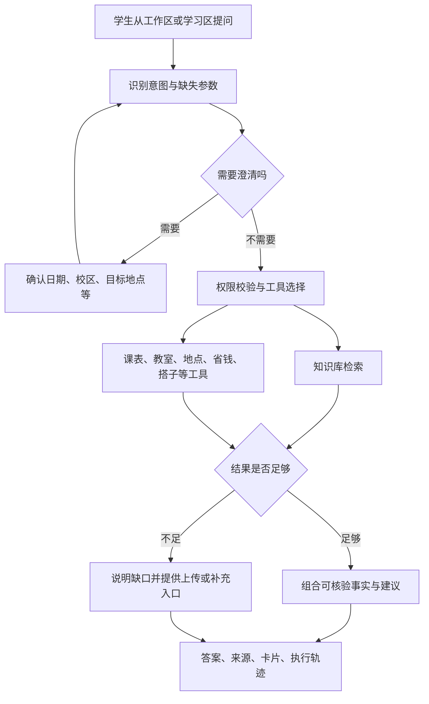
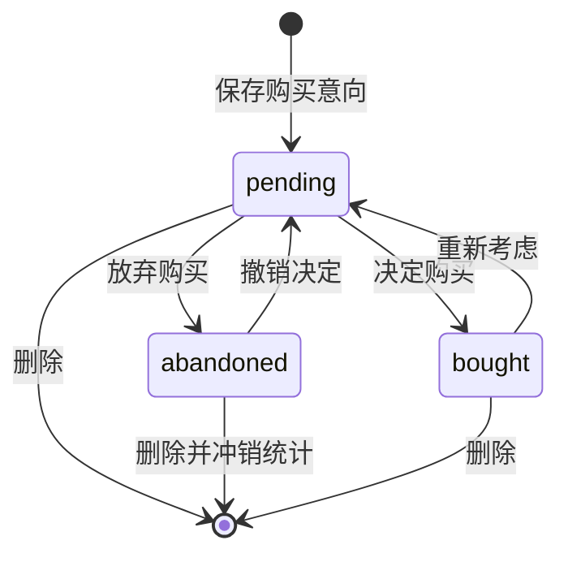
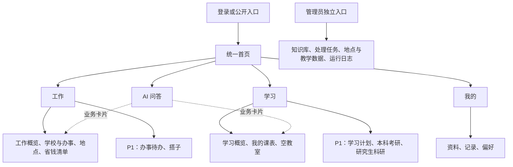
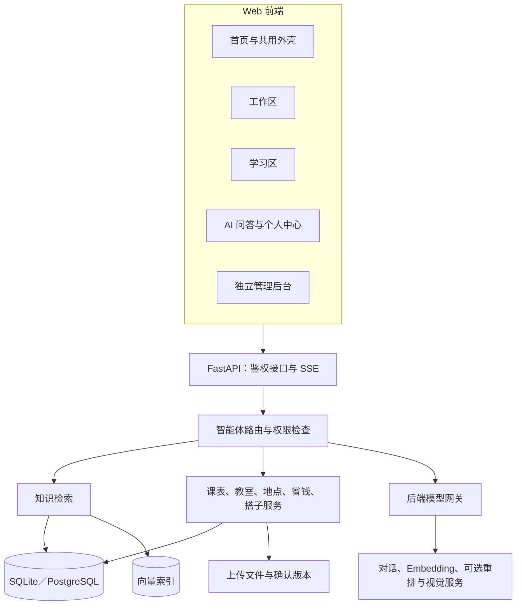

# 校园智伴 · 需求分析与技术方案书

| 项 | 内容 |
|---|---|
| 版本 | v0.6（工作／学习双区重组与可验收需求） |
| 更新日期 | 2026-10-27 |
| 面向院校 | 江苏师范大学 |
| 面向用户 | 本科生、研究生、平台管理员 |
| 产品结构 | 工作部分 + 学习部分，共用账号、智能问答、个人中心与管理后台 |
| 交付形态 | 可视化 Web 应用、RAG 与智能体工具调用、部署演示及真实开发证据 |
| 核心开发工具 | 华为云码道（AI Coding），按赛事要求保留账号与开发过程记录 |
| 文档状态 | 待实现的需求基线；需求、原型和验收案例不代表功能已经实现 |

> 本次修订依据：现有 v0.5 需求、用户提出的“工作部分和学习部分”、dut-orientation 的实际页面与交互，以及用户提供的赛题说明。
>
> **待确认的范围假设：**“工作部分”暂指学生的校园事务与日常办事，承接校园信息、办事指引、地点导航、省钱清单、搭子等已有需求。学生会／社团项目协作、会议纪要、实习招聘不自动列入首期。如果“工作”实际指这些方向，需要调整工作区的功能清单。此处为设计假设，不作为用户已确认决策。
>
> 版本沿革：v0.2–v0.4 确定省钱清单、知网跳转、搭子测评、学校信息知识化等业务边界；v0.5 补充布局；v0.6 按工作／学习重组功能、导航和页面，补齐参考证据、状态流转、权限、数据模型与验收标准，并纠正 Docker 和模型平台被写成强制要求的问题。

## 1 项目定位与范围

### 1.1 项目目标

面向本科生和研究生，提供一个同时支持校园办事与学习安排的智能体 Web 平台：工作区帮助学生找到办事信息、地点与生活协同入口；学习区帮助学生整理课表、查找自习空间和规划学习；学生也可直接通过统一 AI 问答完成跨区查询。

回答需区分三类依据：知识库文档、业务工具结果和模型建议。涉及时间、地点、课程等事实时，先查询已有数据；数据不足则说明缺口，不把模型猜测显示成学校事实。

### 1.2 两部分的职责

| 业务部分 | 用户要完成的事 | 首期核心能力 | 扩展能力 |
|---|---|---|---|
| 工作部分（范围暂定） | 查办事流程、找办事地点、管理购买意向、寻找同伴 | 校园／办事知识问答、地点别名解析与导航、省钱清单 | 办事待办、搭子帖、趣味测评与标签匹配 |
| 学习部分 | 整理上课安排、找到空闲教室、获得有依据的学习建议 | 课表上传与人工确认、周课表、课表查询、基于已收录数据的空教室查询 | 学习计划、本科考研规划、成绩分析、研究生论文检索 |
| 共用能力 | 登录后在两区连续使用服务 | 登录、个人资料、AI 问答、引用与工具轨迹、后台知识库管理 | 全局搜索、收藏、消息通知 |

“工作／学习”是业务场景，“本科生／研究生”是用户画像，“学生／管理员”是权限角色，三者分别建模。任何学生均可进入两个业务区；本科／研究生偏好只改变默认内容和推荐，不改变访问权限。

### 1.3 真实问题与价值

| 问题 | 典型表现 | 解决方式 |
|---|---|---|
| 办事信息分散 | 不清楚材料、办理地点、入口及信息是否过期 | 从学校公开资料整理知识库，回答展示来源、适用范围与更新时间 |
| 校园口语名称难定位 | 同一教学楼有楼号、正式名、学生常用叫法 | 维护标准地点与别名关系，再生成坐标导航链接 |
| 课表信息难复用 | 截图、PDF 和 Excel 格式不统一，选修课与单双周容易录错 | 解析后预览，人工纠错，保存个人课表并提示冲突 |
| 学习安排与真实时间脱节 | 生成的计划和已有课程重叠 | 查询确认后的课表，计算可用时段，再形成可编辑的计划草稿 |
| 冲动消费缺少缓冲 | 想买、决定买、放弃购买混在一起 | 省钱清单保留决策状态，只统计最终放弃购买的金额 |
| 找同伴信息容易沉底 | 时间、地点和兴趣难匹配 | 独立搭子帖与标签筛选，趣味测评提供自选标签建议 |

地点别名、学院设置、开放时间等必须由资料证明。原稿中的“静远楼＝9 号楼”等对应关系作为待核验示例，不在未经核验时录入正式知识库。

### 1.4 首期边界

保留既有取舍：学校／学院／专业介绍走知识库问答，不建设独立学院专业目录；省钱清单仅做 Web；搭子独立于通用社区；知网只做关键词跳转；不恢复原项目的跑腿和通用社区，不引入支付与交易担保。

首期覆盖两区的业务闭环与 AI 全链路。测评、复杂推荐、资料综述、志愿服务、职业规划等按优先级后移；参考产品出现的功能不自动变成本作品的必做功能。

## 2 用户、权限与用户故事

### 2.1 用户角色

| 角色／画像 | 核心需求 | 页面与权限 |
|---|---|---|
| 访客 | 了解产品与学校公开信息 | 可看公开介绍；保存课表、发布内容、查看个人记录时引导登录 |
| 学生 | 使用工作区与学习区 | 管理本人课表、省钱清单、会话、搭子资料；查看允许公开的内容 |
| 本科生画像 | 课程、自习、考研、成绩 | 学习区默认展示课程与考研入口；科研入口仍可使用 |
| 研究生画像 | 课程、论文、科研方向 | 学习区默认展示科研与论文入口；基础课表功能仍可使用 |
| 管理员 | 维护信息与数据质量 | 进入独立后台维护知识库、地点、共享课表和教学数据，处理举报与失败任务 |

本科／研究生由用户主动选择，可在个人中心修改，不根据学号推断身份。管理员权限由服务端授予，不能通过切换画像或修改前端参数获得。

### 2.2 核心用户故事

| 编号 | 用户故事 | 成功结果 |
|---|---|---|
| US-W1 | 作为学生，我想知道补办校园卡需要哪些材料、去哪里办理 | 得到有来源的材料与流程，能继续打开已核验地点卡片 |
| US-W2 | 作为学生，我想先记录一个想买的东西，过几天再决定 | 能查看三态清单，放弃购买后统计只增加一次 |
| US-W3 | 作为学生，我想找到时间和地点都合适的搭子 | 看见可解释的标签与时间交集，自主选择联系或发布 |
| US-L1 | 作为学生，我想把课表截图变成可以查询的周课表 | 确认前不生效，保存后周次、单双周与课程地点正确 |
| US-L2 | 作为学生，我想知道明天下午下课后哪里可以自习 | 组合课表、已收录教室安排和地点数据，列出查询日期及数据范围 |
| US-L3 | 作为学生，我想安排复习但不占用上课时间 | 计划草稿避开已确认课程，可编辑后再保存 |
| US-A1 | 作为管理员，我想更新一条过期办事政策 | 新版本启用后检索使用新内容，旧版本有记录且不再参与当前回答 |

## 3 参考项目分析与设计取舍

### 3.1 参考依据与边界

参考仓库：[Lakitaker608/dut-orientation](https://github.com/Lakitaker608/dut-orientation)。本次核对了本地同名仓库中的 HTML、CSS 和 JavaScript；仓库未发现独立的需求分析 Markdown，因此以下需求拆解来自页面及交互代码，不冒称作者原始需求说明。未实际运行验证的外部服务，不作为已验证能力。

| 证据文件 | 页面／交互中可观察的做法 | 本作品可借鉴的需求 |
|---|---|---|
| [index.html](https://github.com/Lakitaker608/dut-orientation/blob/master/index.html)、[entrance.html](https://github.com/Lakitaker608/dut-orientation/blob/master/entrance.html) | 入口重定向、按报到状态分流、独立姓名设置卡、校园背景与双卡片 | 首次访问提供工作／学习两个清晰入口，个人资料按需补充 |
| [dut-orientation.html](https://github.com/Lakitaker608/dut-orientation/blob/master/dut-orientation.html) | 固定侧栏、粘性顶栏、欢迎横幅、快捷卡片、报到清单及进度、聊天主区与辅助栏 | 门户页给出明确下一步；办事流程以材料、步骤、地点组织 |
| [campus-life.html](https://github.com/Lakitaker608/dut-orientation/blob/master/campus-life.html) | 学习规划、地点、周边生活、竞赛和职业等视图；学习画像选择后进入助手；上传课表文件辅助规划 | 按用户目标组织入口；学习画像与课表用于辅助建议；不照搬专业模板当真实课表 |
| [profile.html](https://github.com/Lakitaker608/dut-orientation/blob/master/profile.html) | 个人资料、测评结果、收藏分区，收藏可分类与搜索 | 两区共用个人中心，统一管理记录与偏好 |
| [account.js](https://github.com/Lakitaker608/dut-orientation/blob/master/account.js)、[favorites.js](https://github.com/Lakitaker608/dut-orientation/blob/master/favorites.js) | 使用姓名与 localStorage 进行本机数据绑定、收藏及存档 | 借鉴操作连续性；本项目使用服务端账号和数据权限校验 |
| [volunteer.html](https://github.com/Lakitaker608/dut-orientation/blob/master/volunteer.html) | 分类卡片、官方平台链接、校内外信息说明 | 常用服务链接按场景分类，清楚标注外链，不承诺站内完成外部业务 |

### 3.2 布局与功能取舍

| 参考做法 | 采用方式 | 不直接沿用的内容 |
|---|---|---|
| 248px 侧栏、右侧主内容、顶栏、卡片栅格 | 桌面端沿用清楚的空间层次，按工作／学习分组导航 | 不保留两个重复概览页及散落多页的账号状态 |
| 欢迎横幅、实景图片、快捷入口 | 首屏以任务入口和今日信息为主，校园图片仅作辅助 | 不使用大工校名、图片、坐标、电话和专业资料填充师大页面 |
| 主聊天区 + 右侧辅助卡片 | 用于智能问答，右栏展示来源和工具执行状态 | 不把模型内部推理过程作为执行记录 |
| 上传文件后规划学习 | 先结构化、校验、人工确认，再按真实课程安排计划 | 不让一张未确认截图直接覆盖课表，不把模板当教务数据 |
| 测评与个人中心 | 保留 12 题校园场景趣味测评和搭子标签 | 不照搬 MBTI 24 题或输出心理诊断结论 |
| 浏览器直连模型 | 统一改为后端模型网关 | 不复制或使用参考仓库中的任何凭据 |
| 清单勾选与进度反馈 | 作为工作区办事待办的 P1 方案 | 不升级为学校审批系统、复杂团队项目管理 |

### 3.3 参考项目与本作品的核心差异

本作品以工作／学习双业务区组织需求，以本科／研究生画像调整推荐，以 RAG 和真实业务工具提供答案，以服务端保存个人数据。参考项目中的页面效果只证明交互设计方式；本作品每项功能仍需通过第 11 章验收，不能用静态卡片替代数据与服务。

## 4 功能需求与优先级

P0：首期验收必须完成；P1：P0 跑通后的增强；P2：后续讨论，本次验收不依赖。需求编号用于关联页面、数据和验收记录。

### 4.1 共用功能

| 编号 | 功能 | 业务规则与输出 | 优先级 |
|---|---|---|---|
| COM-01 | 登录与个人资料 | 服务端账号；本科／研究生、学院、专业、年级、校区、默认业务区均可编辑；个人资料非公共知识 | P0 |
| COM-02 | 双区入口与切换 | 全站明确显示工作／学习；切换不要求重新登录，刷新可恢复当前路由 | P0 |
| COM-03 | 智能问答 | 支持知识类、业务类及跨区组合问题；输出答案、引用、工具结果卡片 | P0 |
| COM-04 | 会话与执行记录 | 保存会话；展示工具状态、必要参数、结果摘要及耗时；支持停止本次生成 | P0 |
| COM-05 | 无数据与失败反馈 | 区分未收录、未上传、无可用结果、权限不足、调用失败；给出对应下一步 | P0 |
| COM-06 | 个人中心 | 我的课表、购买决策、会话历史；搭子、收藏等仅在对应功能启用时显示 | P0 |
| COM-07 | 全局搜索 | 跨知识文档、地点与可公开搭子内容检索；个人省钱记录只能由本人检索 | P1 |
| COM-08 | 收藏与通知 | 收藏地点、回答、搭子帖；回复与举报处理结果通知；用户可清除已读状态 | P2 |

### 4.2 工作部分（按暂定范围）

| 编号 | 功能 | 业务规则与输出 | 优先级 |
|---|---|---|---|
| W-01 | 校园与办事问答 | 学校概况、学院专业、校园卡、图书馆、办事材料和流程等统一走知识库；标来源和适用范围 | P0 |
| W-02 | 常用服务入口 | 分类展示学校官方教务、图书馆、一卡通、VPN 等链接；标题说明将打开外部网站 | P0 |
| W-03 | 地点查询与导航 | 支持别名、楼号、正式名；多义时澄清；展示标准地点、校区、已核验坐标及可选开放时间 | P0 |
| W-04 | 省钱清单 | 发布商品名、预估价格、用途、可选图片；默认仅本人可见；支持编辑、筛选和删除 | P0 |
| W-05 | 购买决策与统计 | 待决定／已放弃／已购买；只有已放弃计省钱；撤销或改价同步重算；重复提交不重复计数 | P0 |
| W-06 | 办事待办 | 将问答中有来源的步骤生成为待办草稿，用户确认后保存；支持勾选、截止时间和完成进度 | P1 |
| W-07 | 搭子帖 | 发布类型、时间、校区／地点、说明；先发后举报；支持关闭、举报及管理处理 | P1 |
| W-08 | 12 题趣味测评 | 参考公开量表结构，自建校园题；结果为兴趣／节奏标签与说明，允许用户修改或删除 | P1 |
| W-09 | 标签匹配 | 根据标签、时间交集、地点筛选；说明匹配原因，不显示未经计算的百分比 | P1 |
| W-10 | 评议与以物换物 | 投票、闲置响应、交换申请与状态流转另立需求；首期不建交换流程和数据表 | P2 |

工作区的“学校与办事”是问答主题入口，不是独立学校／学院／专业目录。省钱清单与搭子帖的可见范围不同：前者默认私有，后者由用户主动发布后对登录用户可见。

### 4.3 学习部分

| 编号 | 功能 | 业务规则与输出 | 优先级 |
|---|---|---|---|
| L-01 | 课表上传与识别 | 首期支持 PNG/JPG、可解析 PDF、XLSX；图片走 OCR／视觉模型，表格优先确定性解析；单文件不超过 10MB | P0 |
| L-02 | 确认与保存 | 预览课程、教师、日期／星期、周次、单双周、节次、地点；缺失与冲突标记；确认前不生效 | P0 |
| L-03 | 周课表与查询 | 完整周一至周日，周切换、回到本周、今日课程；支持自然语言查课；点击课程可打开已核验地点 | P0 |
| L-04 | 空闲教室查询 | 按校区、日期、时段查询；必须有覆盖对应教室和时段的数据；显示来源、更新时间与覆盖范围 | P0 |
| L-05 | 专业／班级共享课表 | 从共享课表复制到个人课表后可调整选修；后续更新需预览差异确认，禁止静默覆盖 | P1 |
| L-06 | 学习计划 | 结合确认课表、目标和可用时间生成可编辑草稿；列出依据与冲突；确认后保存 | P1 |
| L-07 | 本科考研规划 | 根据已维护院校、专业和分数线资料回答；年度与来源必须明确；缺数据时不预测分数 | P1 |
| L-08 | 成绩分析 | 使用用户导入或明确标注的演示数据；绩点／均分按公开计算口径展示；不宣称已接真实教务 | P1 |
| L-09 | 研究生论文检索 | 提取、编辑关键词并跳转知网；站内不抓取或聚合知网结果，不提供绕过登录的全文下载 | P1 |
| L-10 | 学习搭子入口 | 对同一搭子模块使用学习／考研标签预筛选，不另建重复帖子或画像 | P1 |
| L-11 | 文献综述辅助 | 仅基于用户提供的题录／摘要辅助生成提纲并保留对应来源；不虚构引文 | P2 |

空闲教室不能由某个学生的个人课表推导。首期采用管理员导入的教学安排或明确标注的样例数据；真实学校接口未授权前不接入。PDF 扫描件无法识别时返回明确错误，保留手工录入入口。

### 4.4 管理后台

| 编号 | 功能 | 业务规则与输出 | 优先级 |
|---|---|---|---|
| ADM-01 | 知识库与版本 | 文档上传、分类、来源 URL、采集日期、适用学年／校区、启停与删除；处理状态可追踪 | P0 |
| ADM-02 | 数据处理 | 解析、切块、向量化、索引状态与数量；失败显示原因和重试；删除／停用同步更新检索范围 | P0 |
| ADM-03 | 地点和教学数据 | 维护别名、校区、坐标、来源；导入教室教学安排并标注真实／样例 | P0 |
| ADM-04 | 问答与运行记录 | 查看失败原因、路由、调用摘要、模型配置状态；模型密钥不返回浏览器 | P0 |
| ADM-05 | 举报与共享课表 | 搭子举报处理、帖子下架、共享课表发布与版本维护 | P1 |

## 5 核心流程与业务规则

### 5.1 统一智能体流程



当前工作区／学习区是路由提示，不能替代实际意图。工作区里询问明日课表，也应调用本人课表工具；不能由于所在页面而回答无关办事文档。

工具错误须区分 `not_imported`、`no_results`、`unknown_place`、`data_outdated`、`permission_denied`、`provider_unavailable`。例如“尚未上传课表”不等于“明天没有课”，“未收录开放时间”不等于“全天开放”。

### 5.2 工作流程：办事问答与地点联动

提出办事问题 → 检索学校适用版本的资料 → 返回材料、步骤、截止时间（若有）与出处 → 解析办理地点 → 显示校区与导航。W-06 启用后，可将步骤生成待办草稿，用户确认后保存。

禁止把“保存待办”显示为“已向学校提交申请”。不访问外部审批系统，不代替学生提交申请或预约。

### 5.3 学习流程：课表双通道

个人上传：文件检查 → 建立解析任务 → OCR／表格解析 → 字段预览与错误提示 → 人工修改 → 冲突检查 → 用户确认 → 保存个人课表 → 周视图与智能体查询。

共享课表：选择校区、专业／班级、年级、学期 → 预览管理员发布版本 → 复制为个人课表 → 调整选修 → 确认保存。共享模板不含姓名和学号；个人课表仅本人可见。

上传状态：`uploaded → parsing → needs_review → confirmed`；解析异常转 `failed`，支持重试或手工录入。重新上传产生新版本，旧版在确认替换前继续生效；重复点击确认不生成重复课程。

课程冲突需按学期、周次集合、星期和起止节次共同判断。单双周不重叠的同一时段不算冲突；地点不能解析时保留原始文本，并允许后续关联标准地点。

### 5.4 学习流程：空教室与学习计划

先查本人课程结束时间 → 获取明确日期／时段 → 查询该时段已收录教室安排 → 判断数据覆盖范围 → 结合地点返回候选教室。只有完整覆盖查询时段的教室，才可标为“在已收录安排中空闲”；不承诺临时活动、门禁、座位实时可用。

L-06 启用后，在用户设定的可用时段内生成计划，排除已确认课程；未维护步行时间时不展示精确通勤分钟数。没有课表时，先说明依据不足，再允许用户选择手工可用时间。

### 5.5 省钱清单与统计



- 金额使用整数分或数据库定点数；预估价格必须为非负数。
- 累计省钱＝当前未删除且状态为 `abandoned` 的意向金额之和；不是“实际收入”或真实消费流水。
- 放弃购买后生成或更新唯一统计记录；重复请求不得重复增加。
- 放弃状态的条目改价、撤销或删除，统计必须同步变化；本月统计按最近一次有效放弃的时间归属。
- 发布、改状态和删除均由本人确认；智能体首期只查询，不擅自修改决策。

### 5.6 地点别名与搭子

地点查询按校区与别名精确匹配优先，其次知识检索，再对候选进行解释。模型只能在已收录候选中选择，不能自行创造坐标和楼号映射；多个候选时展示选择卡片。

搭子帖按 `open／closed／removed` 管理，首发后可举报，管理员处理留记录。测评答案到标签的映射使用可复现规则；画像是兴趣与作息偏好，不是诊断。学习区和工作区共用帖子，按标签提供不同入口。匹配不足时允许用户修改筛选，不补造用户或帖子。

### 5.7 知识维护流程

学校官网等公开资料 → 人工整理并记录来源、采集日期、适用范围 → 上传文档 → 解析切块与向量化 → 预览可检索片段 → 启用版本 → 学生提问 → 来源引用与反馈 → 管理员修订。

学校／学院／专业介绍均由这一流程提供，不运行未经定义的实时爬取任务。知识文档的启用状态与解析状态分开：只有解析成功且启用的有效版本参与回答。

## 6 信息架构与前端布局

### 6.1 导航原则

一个应用外壳、两个业务区、一套共用能力。全局主导航固定为 **首页／工作／学习／AI 问答／我的** 五项；管理后台为管理员专属入口，不混入学生的工作区。工作区与学习区使用页内二级导航，不再将所有功能平铺成同级菜单。



工作／学习切换保留各自的页内筛选、滚动位置和未提交草稿；关闭或刷新前若有未保存内容，需提示。默认业务区保存为个人偏好，但直接访问链接时以链接为准。课程与学习搭子不复制到工作区另建一份数据。

### 6.2 页面、路由和操作

以下路由为待实现设计，不表示文件或接口已存在。浏览器返回／前进、直接访问与刷新均须能恢复对应页面。

| 页面／建议路由 | 主体内容 | 主要操作与结果 | 对应需求 |
|---|---|---|---|
| 首页 `/` | 问候与校区、工作／学习双入口、今日课程摘要、最近记录、统一提问框 | 进入业务区或携带问题进入问答 | COM-02/03 |
| 工作概览 `/work` | 办事提问框、4 个快捷入口、常用服务、省钱摘要；待办与搭子按 P1 启用 | 查流程、找地点、记购买意向 | W-01/02/04 |
| 学校与办事 `/work/services` | 问答主题卡片、常用链接、来源提示；不展示学院专业树 | 点击主题携带问题进入 AI 问答 | W-01/02 |
| 地点 `/work/places` | 校区筛选、别名搜索、候选地点、详情抽屉 | 澄清候选、导航、反馈错误 | W-03 |
| 省钱清单 `/work/savings` | 本月／累计省钱、分类与状态筛选、商品卡片 | 新增、编辑、确认决策、撤销、删除 | W-04/05 |
| 办事待办 `/work/tasks` | 到期分组、步骤清单、完成进度 | 接收已确认草稿、编辑、勾选、删除 | W-06，P1 |
| 搭子 `/work/buddies` | 类型、时间、地点筛选，测评入口、帖子列表 | 发帖、测评、查看匹配依据、关闭／举报 | W-07/08/09，P1 |
| 学习概览 `/study` | 学期／周次、今日课程、课表上传、空教室入口；画像推荐 | 导入课表、查课程、进入考研／科研 | L-01/03/04 |
| 我的课表 `/study/schedule` | 完整周视图、学期周次、上传与确认抽屉、冲突提示 | 预览纠错、保存、关联地点、删除／替换 | L-01/02/03/05 |
| 空教室 `/study/classrooms` | 日期／时段／校区筛选、来源与覆盖范围、候选卡片 | 查询、定位教室、进入地点详情 | L-04 |
| 学习计划 `/study/plans` | 目标输入、可用时间、计划草稿、冲突提示 | 编辑、确认、保存与重排 | L-06，P1 |
| 升学科研 `/study/growth` | 本科考研／研究生科研 Tab，知识问答与知网关键词框 | 切换主题、查看来源、打开知网 | L-07/08/09，P1 |
| AI 问答 `/assistant` | 会话、输入与附件、来源卡、业务结果与执行轨迹 | 提问、追问、停止、打开业务页 | COM-03/04/05 |
| 我的 `/me` | 资料、默认业务区、课表与购买记录、历史会话 | 修改画像、查看数据、注销登录 | COM-01/06 |
| 管理后台 `/admin` | 知识库、处理任务、地点和教学数据、日志；P1 举报 | 上传、启停、重试、导入、处理问题 | ADM-01–05 |

P1／P2 页面未实现时不显示可点击的空壳入口；原型若展示规划项，需明显标注“规划中”。

### 6.3 统一布局规范

| 项目 | 桌面：宽度 ≥1100px | 平板：720–1099px | 移动：宽度 <720px |
|---|---|---|---|
| 主导航 | 固定 248px 侧栏，五个全局入口、账号区 | 72px 图标栏，保留文字提示与选中状态 | 顶部标题与必要操作，底部五项 Tab；更多操作用抽屉 |
| 业务二级导航 | 工作／学习内容标题下的分段导航 | 可横向滚动 Tab | 同上；当前业务与当前位置清楚可见 |
| 顶栏 | 64px，粘性，标题／面包屑、校区、头像 | 60px | 56px，操作收敛为一个主按钮与更多菜单 |
| 内容 | 最大 1200px，居中，内边距 32px | 内边距 24px | 内边距 16px；为底部导航和安全区域留白 |
| 栅格 | 快捷入口 4 列，信息卡 2–3 列 | 2 列 | 1–2 列，长说明单列 |
| 问答区 | 主区自适应 + 300px 右侧来源／轨迹栏 | 辅助栏改抽屉 | 答案单列，来源与执行记录按消息折叠展开 |
| 周课表 | 时间轴 + 周一至周日七列 | 容器内横向滚动 | 默认今日列表，可切换七日周表；仅表格内部滚动 |

所有布局需在 375px、768px、1440px 视口验证。侧栏不能覆盖主要按钮，页面整体不出现横向滚动；周表内部横向滚动为明确例外。学习与工作采用同一套组件与字号，通过区名、图标和内容区别，不仅依靠颜色。

### 6.4 设计令牌（提案）

| 类别 | 取值 | 使用规则 |
|---|---|---|
| 品牌主色 | `#1B4B8F` | 主按钮、选中态、重点标题；属于本项目暂定配色，不声称是学校官方标准色 |
| 辅助强调 | `#D9A441` | 少量用于统计与重点提示；普通文字需验证对比度 |
| 背景／卡片／边框 | `#F6F7F9`／`#FFFFFF`／`#E4E8EE` | 保持清楚层次，避免大面积渐变影响阅读 |
| 文字 | 主 `#0F1B2D`，次 `#4A5A70` | 说明文字不因“次要”而无法辨认 |
| 状态 | 成功 `#16A34A`、警告 `#B7791F`、错误 `#DC2626` | 同时配文字／图标，不只用颜色表达 |
| 字体 | 系统字体栈、微软雅黑、PingFang SC | 正文 14–16px，正文行高 1.6；标题层级固定 |
| 圆角／间距 | 卡片 14px、大卡片 20px、按钮 10px；间距 4/8/12/16/24/32px | 公共组件统一使用 |
| 动效与操作 | 150–250ms 轻量切换；触控操作区建议不小于 44px | 尊重减少动态效果偏好，避免滚动装饰干扰任务 |

校园图片须使用团队有权使用的江苏师范大学素材；无图片时使用纯色布局。配色与示例数据可调整，但结构与交互必须遵守本章要求。

### 6.5 关键页面线框

以下为布局约束，内容和数值均为示意，不能当作真实学校信息或验收结果。

**统一首页：两个清晰入口，而非将所有功能堆在首屏。**

```text
┌────────────┬─────────────────────────────────────────────┐
│ 校园智伴   │ 首页                     校区选择   个人中心 │
│ 首页       ├─────────────────────────────────────────────┤
│ 工作       │ 你好，某同学。今天想完成什么？               │
│ 学习       │ [输入问题：查办事流程、课表或校园地点……]    │
│ AI 问答    │ ┌───────────────────┐ ┌───────────────────┐ │
│ 我的       │ │ 工作              │ │ 学习              │ │
│            │ │ 办事·地点·省钱    │ │ 课表·自习·规划    │ │
│            │ │ [进入工作区]      │ │ [进入学习区]      │ │
│            │ └───────────────────┘ └───────────────────┘ │
│ 账号／设置 │ 今日课程摘要             最近会话与操作记录 │
└────────────┴─────────────────────────────────────────────┘
```

**工作概览：办事与生活协同。**

```text
┌─────────────────────────────────────────────────────────┐
│ 工作    [概览][学校与办事][地点][省钱清单][搭子·P1]      │
│ [你要办什么事？ 输入问题并查询]                          │
│ [学校与办事] [找地点] [记一笔购买意向] [找搭子·P1]      │
├───────────────────────────────┬─────────────────────────┤
│ 常用服务：图书馆／教务／VPN   │ 我的购买决策与省钱摘要  │
│ 常见问题 → AI 问答            │ 办事待办与进度（P1）    │
│ 信息来源与更新提示            │ 最近地点                │
└───────────────────────────────┴─────────────────────────┘
```

**学习概览：先呈现真实课程，再提供建议。**

```text
┌─────────────────────────────────────────────────────────┐
│ 学习    [概览][我的课表][空教室][学习计划·P1][升学科研]  │
│ 学期／第几周                  画像：本科生／研究生     │
│ [上传课表] [看本周] [查空教室] [考研／科研·P1]         │
├───────────────────────────────┬─────────────────────────┤
│ 今日课程时间轴                │ 课表状态：已确认／待审  │
│ 课程 → 地点卡片               │ 自习查询快捷条件        │
│ 无课表时：[上传][手工录入]    │ 学习计划草稿（P1）      │
├───────────────────────────────┴─────────────────────────┤
│ [帮我安排本周复习，但避开已确认课程……] → AI 问答       │
└─────────────────────────────────────────────────────────┘
```

**智能问答：对话与可核验结果。**

```text
┌──────────────────────────────────────┬──────────────────┐
│ 当前会话 · 学习场景                  │ 来源与执行记录   │
│ 用户：明天下午下课后哪里能自习？      │ 查询本人课表 ✓   │
│ 助手：给出基于数据的时间与地点        │ 查询教室安排 ✓   │
│ [课程卡] [候选教室卡] [地点卡]        │ 解析地点 ✓       │
│ [来源：教学安排版本／查询日期]        │ 耗时、数据范围   │
│                                      │ 无结果／失败说明 │
│ [附件] [输入问题……] [发送／停止]    │                  │
└──────────────────────────────────────┴──────────────────┘
```

**课表页：全周展示与确认流程。**

```text
学期  第N周 [上一周][本周][下一周]    [上传][手工录入]
        周一  周二  周三  周四  周五  周六  周日
1–2节   课程        课程
3–4节         课程                    课程
5–6节                     课程
右侧／移动端抽屉：原始文件 → 识别字段 → 缺失／冲突提示
                          [取消][确认保存]
```

### 6.6 关键组件与状态

| 组件 | 必需内容 | 交互与异常 |
|---|---|---|
| 场景切换／导航 | 工作、学习、当前位置、选中态 | URL 可恢复；切换不丢未保存输入；窄屏仍有文字标签 |
| 引用卡片 | 文档标题、适用范围、来源链接、更新时间、片段标识 | 可展开原文；无来源时明确提示未配置，不能伪造引用 |
| 工具轨迹 | 工具名称、状态、结果摘要、耗时 | 状态为等待／运行／成功／无结果／失败；不输出密钥或内部推理文本 |
| 课程／教室卡 | 日期、周次、课程或教室、时间、地点、数据来源 | 冲突醒目标记；未知地点可反馈；教室显示数据覆盖范围 |
| 地点卡 | 正式名、别名、校区、来源、已核验坐标 | 多义先选择；缺坐标禁用导航并说明，缺开放时间不补默认值 |
| 省钱卡 | 商品、金额、状态、最近决策时间 | 改状态与统计同步；本人操作，重复点击不重复累计 |
| 搭子卡（P1） | 类型标签、时间、地点、说明、匹配依据 | 关闭／举报入口可见；联系方式不直接公开 |
| 通用状态 | 加载、空、成功、失败、未登录、无权限 | 网络失败保留输入并支持重试；空态给出上传／新增等下一步 |
| 数据处理进度 | 解析／切块／向量化／索引阶段与数量 | 后端无总进度时仅显示阶段，不能用假百分比模拟完成 |

输入框、按钮、Tab 和弹窗均需支持键盘操作与可见焦点；图标按钮提供名称；弹窗关闭后焦点回到触发位置。生成建议和用户已保存结果在文案、颜色与状态上明确区分。

## 7 数据模型与一致性约束

下表为建议逻辑模型。campus-smart-agent 当前以需求文档为主，不把表结构描述为“已扩展完成”；复用 campus-smart-service 时需先核对实际迁移与模型。

| 表／实体 | 关键字段 | 约束与归属 |
|---|---|---|
| `users` | id, account, password_hash, access_role | `access_role` 为 student/admin；密码不明文存储 |
| `user_profiles` | user_id, degree_level, college, major, grade, campus, preferred_workspace | 本科／研究生画像与权限分开；本人可修改 |
| `knowledge_bases` | id, name, domain, topic, status | domain 为 common/work/study；主题推荐不等于权限控制 |
| `knowledge_documents` | id, kb_id, version, source_url, collected_at, valid_scope, process_status, enabled, chunk_count | 处理状态与启用独立；旧版可追溯 |
| `document_chunks`／向量索引 | chunk_id, document_id, version, content, metadata | 删除／停用时同步过滤或清理；引用可回溯 |
| `processing_tasks` | id, resource_id, stage, status, error_code, retry_count | 记录真实进度；重试不产生重复有效片段 |
| `campus_places` | id, campus, standard_name, building_no, lat, lng, open_hours, source_url, verified_at | 坐标注明坐标系；未知字段可为空 |
| `place_aliases` | id, alias, campus, place_id, source | 规范化别名并结合校区；允许同名多候选 |
| `schedules` | id, user_id, term, source_type, source_version, status, confirmed_at | 区分个人确认版与解析草稿 |
| `schedule_courses` | id, schedule_id, name, teacher, weekday, start_section, end_section, weeks, raw_place, place_id | 有效星期1–7、节次合法、周次为集合；保留原始地点 |
| `shared_schedules`（P1） | id, college, major, class_name, grade, term, version, published_by | 不含姓名／学号；复制与后续更新需确认 |
| `classroom_occupancies` | id, campus, place_id, date_or_weeks, time_range, source, updated_at, is_demo | 与个人课表分开；记录覆盖范围与来源 |
| `purchase_intents` | id, user_id, name, price_cent, purpose, image, category, status, decided_at, deleted_at | 默认本人可见；状态变更和统计保持一致 |
| `saving_records` | id, user_id, intent_id, saved_cent, effective_at | intent_id 唯一；撤销／删除同步冲销 |
| `work_tasks`（P1） | id, user_id, title, due_at, status, source_message_id | 本人待办，不是审批单；来源可追溯 |
| `work_task_steps`（P1） | id, task_id, content, sort_order, completed_at | 完成数／总数计算进度，不使用假进度 |
| `study_plans`（P1） | id, user_id, goal, period, schedule_version, status | 草稿／已确认分开；课表变更后提示重新检查冲突 |
| `study_plan_items`（P1） | id, plan_id, title, start_at, end_at, status | 起止时间合法，与已确认课程检查冲突 |
| `buddy_posts`（P1） | id, user_id, purpose, tags, time_slot, campus, place_id, status | 工作／学习共用；purpose 与筛选关联 |
| `buddy_profiles`（P1） | user_id, assessment_version, answers, tags, intro, preferences | 版本化规则，可修改／删除；不公开原始答卷 |
| `reports`（P1） | id, reporter_id, target_type, target_id, reason, status, handled_at | 管理员处理可追踪 |
| `chat_sessions` | id, user_id, workspace, title, created_at | 按用户隔离，业务区仅作上下文标识 |
| `chat_messages` | id, session_id, role, content, citations, tool_trace, status | 停止／失败可保存部分结果，但明确状态 |
| `qa_logs` | id, user_id, session_id, route, model, latency_ms, status, error_code | 不记录密钥；诊断内容避免无必要的个人数据 |
| `favorites`（P2） | id, user_id, target_type, target_id | 唯一(user_id,target_type,target_id) |

共同约束：个人记录通过服务端登录上下文确定归属；时间按统一时区处理；金额使用定点类型；删除必须处理引用与统计一致性；展示数据来源和样例标记不能仅存在数据库而不显示在页面。

## 8 AI 问答模式与接口契约

### 8.1 RAG 与工具组合

知识类问题检索文档，个人课表、教室、地点、省钱清单与搭子问题调用结构化工具；混合问题组合执行。学校／学院／专业等基础信息统一由知识库提供。可以使用规则处理明确查询，模糊查询由模型辅助，所有结果受数据范围与权限约束。

模型建议与事实分别展示；只有模型服务成功返回的结果可标注为模型生成。网络断开时仅展示已保存数据和本地摘录，不宣称完整离线 AI 已实现。

### 8.2 模型网关与配置

华为云码道是赛事要求的开发工具；用户提供的赛题未指定推理模型提供方，也未要求必须使用 MaaS、Docker 或自行训练模型。模型平台可优先评估华为云生态或其他兼容服务，以团队实际配置为准。

| 配置类别 | 建议配置 | 说明 |
|---|---|---|
| 对话 | `QA_BASE_URL`, `QA_API_KEY`, `QA_MODEL`, `QA_TIMEOUT_SECONDS` | 复用原项目命名；兼容服务可走 `/chat/completions` |
| 向量 | `EMBEDDING_PROVIDER`, `EMBEDDING_BASE_URL`, `EMBEDDING_API_KEY`, `EMBEDDING_MODEL`, `EMBEDDING_DIM` | 向量使用 embeddings 接口或相应适配器，不能与聊天接口混为一谈 |
| 重排 | `RERANK_PROVIDER`, `RERANK_BASE_URL`, `RERANK_API_KEY`, `RERANK_MODEL` | 可选；服务协议由适配器处理 |
| OCR／视觉 | `DOCUMENT_OCR_ENABLED`, `DOCUMENT_OCR_BASE_URL`, `DOCUMENT_OCR_API_KEY`, `DOCUMENT_OCR_MODEL` | 扫描图像提取；结果先人工确认 |
| 备选 | 独立的备选模型配置 | 实际可用才启用；本地 Ollama 需单独安装和准备模型 |

所有密钥保存在后端配置中；后台仅展示脱敏状态。前端不得接收真实密钥。支持的格式和能力以实际服务为准，不能把“OpenAI 兼容”理解为所有厂商接口完全一致。

### 8.3 混合检索

建议采用向量检索 + 关键词检索 + RRF 融合，重排可选。初始参数：每路 Top-10，融合后取 Top-6，单片段最多 800 字，总证据上下文最多 4000 字；根据评测调整，作为设计参数而非效果承诺。

引用至少包含 chunk_id、文档 ID／版本、标题、来源 URL（若有）、适用范围与更新时间。无有效片段时明确返回未收录；停用或删除的文档不能继续被当前检索命中。

### 8.4 工具与权限

| 工具 | 入参（由用户问题提供） | 输出 | 归属／优先级 |
|---|---|---|---|
| `search_knowledge` | query, domain, topic, campus | 片段、版本、来源与适用范围 | 共用，P0 |
| `resolve_place` | query, campus | 候选／标准地点、已核验坐标、导航链接 | 工作，共用，P0 |
| `get_schedule` | date 或 week_no | 本人有效课表及版本 | 学习，P0 |
| `get_free_classrooms` | campus, date, time_range, optional_building | 教室列表、覆盖范围、样例标记 | 学习，P0 |
| `search_purchase_intents` | keyword, status | 本人清单摘要 | 工作，P0 |
| `get_saving_summary` | period | 本人统计、口径、有效条目数量 | 工作，P0 |
| `search_buddy_posts` | tags, purpose, time_slot, campus | 可公开帖子及匹配依据 | 跨区，P1 |
| `draft_work_checklist` | question, verified_steps | 带来源的待办草稿 | 工作，P1 |
| `draft_study_plan` | goal, period, availability | 计划草稿及冲突检查结果 | 学习，P1 |
| `open_cnki_search` | keywords | 用户可确认打开的知网检索链接 | 学习，P1 |

user_id 从后端登录上下文注入，不允许模型任意指定。首期智能体工具以查询和生成草稿为主；保存课表、改购买决策、发搭子帖等操作通过前端确认后的鉴权接口执行。

如采用 Function Calling，最多 3 轮调用；依赖前一个工具结果的调用顺序执行，无依赖查询可并行。超过限制、缺少参数或权限不足时明确终止，不能反复调用或补造成功记录。

### 8.5 会话与事件

按 user_id + session_id 隔离；默认保留最近 6 轮上下文，更早内容可生成带状态的简短摘要。画像只注入用户主动填写的信息；工作／学习切换不自动合并不同会话。用户可继续原会话或新建另一业务区会话。

后端通过 SSE 输出；前端使用支持 POST 与鉴权的流式请求处理。事件带 request_id 和顺序号，重连／重试不重复保存消息。

| 事件 | 主要数据 | 前端行为 |
|---|---|---|
| `token` | 增量答案文本 | 增量渲染 |
| `citation` | 来源、文档版本、片段标识 | 挂载来源卡片 |
| `tool_call` | call_id、工具名、脱敏参数、状态 | 新增或更新同一轨迹条 |
| `tool_result` | call_id、结果类型、摘要、耗时 | 展示课程／地点／统计等结构化卡片 |
| `done` | 最终状态、总耗时、是否降级 | 结束生成并允许下一次发送 |
| `error` | 错误码、可重试标记、说明 | 保留输入与部分输出，提示重试 |

### 8.6 降级与数据边界

主模型失败时可切换已配置的备选模型一次；都不可用时返回本地检索片段与来源，标注“未调用大模型”。向量模型不可用时可使用关键词检索，并标明检索方式；不能把占位向量标为真实语义检索。

OCR 不可用时保留表格解析和手工输入；教室数据过期或范围不全时标注限制；工具无数据时返回缺失类型。外部文档和用户上传文本作为待检索资料，不作为更改系统权限、执行命令或泄露凭据的指令。

## 9 建议架构与部署方式



前端建议使用 Vue 3 + Vite + 统一路由／状态管理；这是实现提案，若团队继续采用现有前端技术，仍需满足双区信息架构、路由恢复与状态要求。后端可复用 campus-smart-service 的 FastAPI 能力，但不自动保留其社区和跑腿模块；复用前核对真实接口与数据模型。

**本地开发优先原生运行：**Python 虚拟环境运行后端，前端使用开发服务器，SQLite 保存本地数据；向量索引采用本地可运行方案或已配置服务。Redis／Celery 仅在实际采用异步任务时引入。Docker Compose 为后续环境复现的可选方案，不是本次功能验收前置条件。

提供启动、停止、示例配置、健康检查与数据初始化说明；启动脚本不得终止未知占用端口的程序。部署验收需分别确认 Web、API、数据存储、模型服务实际状态。未配置模型密钥时可运行基础功能，但 AI 全链路验收需使用实际模型并留证。

## 10 非功能需求与评测口径

下列性能为待验证目标，不作为已测结果。记录测试设备、模型、网络、数据量与请求数，分别统计本地业务耗时和外部模型耗时。

| 类别 | 要求／目标 | 验证方式 |
|---|---|---|
| 权限 | 个人课表、省钱清单、会话仅本人可访问；后台需管理员权限 | 两个学生账号和一个管理员账号进行越权验证 |
| 数据保护 | 共享课表不包含身份字段；上传文件按用户隔离；不采集真实学校账号密码 | 检查导入／导出与文件访问权限 |
| 可靠性 | 重复保存、任务重试、决策变更不产生重复数据；重启后数据保留 | 重复请求与重启验证 |
| 可解释 | 事实答案有真实依据；工具失败、数据缺口、样例与降级状态均可见 | 固定问题集逐条核对 |
| 本地接口性能 | 常规列表／结构化查询 P95 目标 ≤1s | 固定演示数据与至少30次请求记录 |
| AI 响应性能 | 目标2s内出现处理状态；模型首个答案文本 P95 目标≤5s、完整回答≤20s | 至少30个测试问题，包含检索与多工具场景；如超标说明原因 |
| 文档处理 | 显示真实阶段与失败原因；不要求瞬间完成，不展示模拟进度 | 多格式文件及错误文件验证 |
| 学习安排 | 课程、单双周、冲突与计划时间可复现检查 | 固定课表样例和边界条件验证 |
| 兼容与可用性 | Chrome／Edge；375px、768px、1440px；键盘可操作；网络错误可重试 | 页面走查与操作录屏 |
| 运维 | 提供脱敏配置、启动停止、健康检查、初始化与模型配置说明 | 新环境按说明执行并记录结果 |

教务数据使用管理员导入、个人上传或明确标注的样例；不会因为处于演示模式而把“样例”标记隐藏。真实模型与本地摘录的成功率、耗时分别记录。

## 11 验收标准与需求追踪

| 编号 | 关联需求 | 操作／前置条件 | 通过标准 |
|---|---|---|---|
| AC-01 | COM-01/02 | 本科生、研究生分别登录；来回切工作／学习并刷新 | 两类学生均可进入双区；画像改变推荐而非权限；路由和本人数据正确恢复 |
| AC-02 | COM-02、布局 | 375/768/1440px 打开首页与双区 | 入口一致可见，无页面级横向溢出；导航不遮挡按钮；周表可独立滚动 |
| AC-03 | W-01、ADM-01 | 上传带来源的办事资料并提问 | 回答事实与资料一致，能查看来源、版本和更新时间 |
| AC-04 | ADM-01/02 | 更新／停用／删除已检索文档，再提问 | 当前答案不再引用失效版本；失败任务可见且可重试 |
| AC-05 | W-03 | 查询正式名、别名、同名多校区、未知地点 | 正确归一或反问；未知不造坐标；导航目标与已核验地点一致 |
| AC-06 | W-04/05 | 新增2000元意向，放弃后重复提交，再撤销／删除 | 省钱只增加2000元一次；撤销／删除恢复；已购买不计入 |
| AC-07 | COM-01、W-04 | 学生B修改URL或请求参数读取学生A的私有数据 | 服务端拒绝，页面不泄露记录 |
| AC-08 | L-01/02 | 上传截图、PDF、XLSX及超限／错误文件 | 合法输入可进入确认；不支持／错误文件明确提示；确认前不改变有效课表 |
| AC-09 | L-02/03 | 样例含周日、单双周、重叠课程及未知地点 | 七天完整，单双周正确，真实冲突高亮；保留未知地点原文；重复确认不重复生成 |
| AC-10 | L-03、COM-05 | 无课表问“明天有课吗”，再上传并确认后重问 | 未导入时明确缺失；导入后只依据本人有效版回答 |
| AC-11 | L-04 | 完整教学数据、部分覆盖、过期和无数据分别查询 | 返回相应覆盖范围和标记；不把数据缺失当作空闲 |
| AC-12 | COM-03/04 | 在任一区询问“明天下课后某楼附近能自习吗” | 查询课表、教室安排、地点并组合结果；轨迹与真实调用一致 |
| AC-13 | COM-03/05 | 关闭模型配置或模拟超时 | 标明模型不可用或本地摘录；不伪装模型生成成功；基础页面仍可用 |
| AC-14 | COM-04 | 流式回答时停止、重试、切换会话 | 停止状态明确、输入保留、不重复保存消息、不串其他用户上下文 |
| AC-15 | W-06（P1） | 问答生成办事步骤后确认保存并勾选 | 保存前是草稿；步骤、来源和进度一致；不提示已提交学校申请 |
| AC-16 | L-05（P1） | 同步共享课表后修改个人选修，再发布新模板 | 不含身份信息，更新需预览确认，个人选修不被静默覆盖 |
| AC-17 | L-06（P1） | 基于确认课表生成计划，调整后保存 | 不与已确认课程冲突；草稿与保存区分；可解释参考数据 |
| AC-18 | W-07/08/09（P1） | 相同答卷两次测评；筛搭子；关闭／举报帖子 | 标签可复现、可修改；匹配有理由；关闭帖子不再推荐；举报可处理 |
| AC-19 | L-09（P1） | 编辑中文关键词并打开知网 | 正确编码外链，说明外部服务；站内不伪造论文结果 |
| AC-20 | 部署、赛题 | 重启服务并完成数据上传→处理→提问→展示 | 数据保留；真实模型链路可用；健康状态、演示与开发证据可对应 |

固定问题集至少包含30条：知识问答、课程查询、地点歧义、空教室数据缺口、跨区组合、越权及模型失败。记录期望工具、实际工具、来源是否正确、耗时和失败原因；不直接采用参考仓库自报指标作为本项目成绩。

## 12 赛题要求映射

| 赛题环节 | 本作品落实内容 | 展示位置／证据 |
|---|---|---|
| 数据／知识库管理 | 工作和学习主题分区、来源版本、地点主数据、教学安排 | 管理后台上传与列表 |
| 数据处理 | 文档解析切块向量化、课表OCR／表格解析、人工确认、处理任务 | 阶段状态、结果预览与失败重试 |
| 模型或智能体构建 | 意图识别、受控工具、跨区编排、无数据反馈 | 工具定义、真实调用日志与问答页 |
| 推理部署 | 运行中的Web、后端、存储、检索与模型接入 | 配置状态、健康检查与部署录屏 |
| 结果可视化 | 双区概览、周课表、教室与地点卡片、省钱统计、引用与轨迹 | 前端演示与验收记录 |
| 核心AI编程工具 | 开发过程实际使用华为云码道 | 对应华为云账号的插件记录、对话、代码修改与录屏 |

根据已提供赛题，码道使用与证明材料属于必须项；CodeArts Repo／流水线、指定模型平台与容器化不写成赛事强制项。可按团队实际情况选用，不替代AI应用本身的完整链路。

## 13 华为云码道留痕与演示方案

### 13.1 真实开发证据

| 阶段 | 建议记录 | 对应产物 |
|---|---|---|
| 需求与设计 | 在码道中讨论双区边界、页面拆解及验收标准 | 真实对话截图、文档diff |
| 数据与知识库 | 码道参与表结构、解析与索引开发 | 代码修改、执行结果与处理录屏 |
| 前端 | 码道参与双区外壳、课表、来源卡与异常状态开发 | prompt、代码diff、页面运行结果 |
| 智能体 | 工具参数、权限校验、多工具路由与排错 | 调用日志、真实对话与测试结果 |
| 业务联调 | 课表确认、省钱状态与统计一致性 | 修改记录、验收用例和截图 |
| 部署排错 | 环境、配置、启动与模型接入 | 录屏、健康检查和复现说明 |

仅归档实际发生的码道使用。本文件当前修订不自动构成码道使用证明；不得将其他工具生成的记录冒充码道记录，也不预写“已由码道完成”的事实。截图与录屏不展示API密钥和密码。

建议证据目录：

```text
evidence/
├── 00-账号与环境/
├── 01-需求与双区设计/
├── 02-知识库与数据处理/
├── 03-工作区/
├── 04-学习区与课表识别/
├── 05-智能体与工具/
├── 06-前端联调/
├── 07-排错与部署/
├── 08-验收与演示/
└── 索引.md
```

索引记录时间、账号、需求编号、改动／提交、证据路径和结果。赛事提交前核对账号归属与记录完整性。

### 13.2 三分钟演示建议

| 时间 | 演示内容 | 重点 |
|---|---|---|
| 0:00–0:25 | 首页进入工作／学习，切换本科／研究生推荐 | 双区清晰，画像不等于权限 |
| 0:25–1:05 | 后台上传办事资料，展示处理，工作区提问并定位办理地点 | 数据→处理→问答→来源与地点 |
| 1:05–2:10 | 上传课表、纠错确认、周视图；问下课后的自习地点 | 真实课表、多工具组合、数据范围 |
| 2:10–2:35 | 新增购买意向、放弃、重复点击与撤销 | 决策状态与统计一致 |
| 2:35–3:00 | 展示模型状态、一次失败反馈与码道证据索引 | 运行与开发过程可追溯 |

采用提前准备的短文档和课表减少等待；真实模型服务和已保存结果分别标明。P1搭子或学习计划可放入补充视频，不挤占P0全链路演示。

## 14 实施里程碑与风险

### 14.1 里程碑

| 阶段 | 内容 | 完成标准 |
|---|---|---|
| M1 范围与骨架 | 确认工作定义、统一路由与账号、双区外壳、原生启动 | 双区与鉴权可用，配置说明齐全 |
| M2 数据与管理 | 知识文档来源版本、地点样例、课表与教学安排模型、后台处理 | 数据能管理，样例与真实来源可区分 |
| M3 AI链路 | 模型网关、检索、P0工具、SSE与轨迹、无数据反馈 | 一个工作问题与一个学习问题全链路通过 |
| M4 业务闭环 | 课表确认／周视图、地点联动、空教室、省钱统计 | AC-01–14核心验收通过 |
| M5 增强与交付 | 根据时间选择P1；响应式、异常处理、部署、码道证据 | P0与AC-20通过，提交材料可复核 |

P0优先完成后再评估办事待办、学习计划、共享课表、搭子、考研科研等P1模块；P1未纳入本次交付时同步收起入口和演示承诺。

### 14.2 风险与处理

| 风险 | 处理 |
|---|---|
| “工作”范围含义未确认 | 暂按校园事务与日常办事组织现有需求，明确为待确认；不自动增加企业办公或招聘系统 |
| 参考项目功能很多，范围失控 | 以需求编号、优先级和验收用例控制范围；不为页面数量复制功能 |
| 课表OCR或字段解析有误 | 人工确认、字段校验、冲突提示、手工录入与版本回退 |
| 教室安排不完整 | 展示覆盖范围、来源与更新时间，不从个人课表推导学校空闲教室 |
| 地点别名、学院或专业资料错误 | 核验来源、维护适用校区和更新时间；缺信息不补造 |
| 消费统计被误解为实际省下现金 | 说明按购买意向估算的口径，处理撤销与删除一致性 |
| 搭子骚扰或不适内容 | 先发后举报、后台处理、关闭帖子，不公开原始测评答案或联系方式 |
| 模型未配置或请求失败 | 实际验证可用性；明确显示本地摘录，不将降级算AI成功 |
| 设计与实际代码不一致 | 本文作为待实现要求；复用项目先核对接口、数据与权限，不宣称已有能力 |
| 码道证据不足 | 从真实开发开始归档，按需求编号建立证据索引 |

明确不纳入首期：真实教务账号登录、校方审批写入、支付、交易担保、实名认证、模型训练、深度地图SDK工程、通用社区和跑腿。知网仅外链检索，不抓取结果页或绕过机构访问权限。

## 15 决策记录与待确认事项

### 15.1 继承现有文档的业务取舍

本节记录原文已有取舍，不代表本次重新获得确认。

| 决策 | 本次处理 |
|---|---|
| 面向江苏师范大学，本科／研究生双画像 | 保留，画像与权限分开 |
| 地点别名清单由需求方提供 | 保留，正式入库前核验地点关系与坐标 |
| 换物首期简化为省钱清单 | 保留，直接换物仍为P2 |
| 仅放弃购买计入省钱 | 保留，补充撤销、改价、删除和幂等规则 |
| 不保留原社区和跑腿；搭子独立实现 | 保留，工作／学习共用同一搭子数据 |
| 12题校园趣味测评、标签和详细类型介绍 | 保留P1，明确非心理诊断，规则可复现 |
| 搭子帖先发后举报 | 保留P1，补充关闭、下架与处理记录 |
| 学校／学院／专业由官网资料整理后问答 | 保留，不建设独立学院专业目录 |
| 研究生论文检索仅知网关键词跳转 | 保留P1；综述辅助仍P2 |
| RAG与Agent混合、后端网关、引用和工具轨迹 | 保留，补充权限与真实执行要求 |
| 桌面侧栏与内容区、移动端适配 | 保留，统一为五项主导航及双区二级导航 |
| 蓝与金配色 | 作为视觉提案保留，不冒称学校官方色值 |

### 15.2 本次明确要求与设计提案

- 用户明确要求：参考 dut-orientation 的需求场景和前端布局，完善本需求文档，并分为工作部分与学习部分。
- 设计提案：五项全局导航、双区概览、独立管理后台、建议路由、响应式线框和验收编号。
- 工作范围假设：校园事务与日常办事；工作待办作为P1提案。尚未确认学生组织协作或实习就业是否应成为工作区主线。
- 技术提案：原生本地运行优先，Docker可选；模型提供方按实际配置选择，不作为赛事强制项。

### 15.3 待确认清单

1. 工作部分最终是校园事务与日常办事，还是学生组织／项目协作，或实习就业？
2. P1中的办事待办、学习计划、共享课表、搭子、考研科研，首期增强优先选哪些？
3. 学校资料与地点清单由谁整理、谁核验、多久更新？
4. 搭子类型最终分类与12题标签映射规则如何确定？原稿建议的学习自习、考研冲刺、运动健身、摄影记录、美食探店、文艺观展、游戏开黑、旅行徒步八类保留为候选。
5. 开发联调用哪一家真实对话／Embedding／视觉服务？哪些能力需要离线运行？
6. 校历、作息、成绩分析的数据样例与来源何时就绪？

未确认事项不会阻塞首页、双区外壳、知识库与课表基础需求的实现；依赖具体学校数据或外部服务的功能，以已核验数据和真实配置为验收前提。
