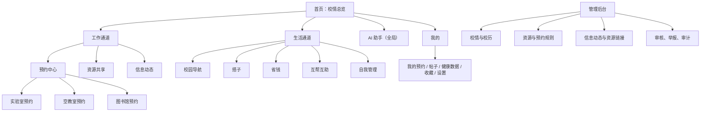
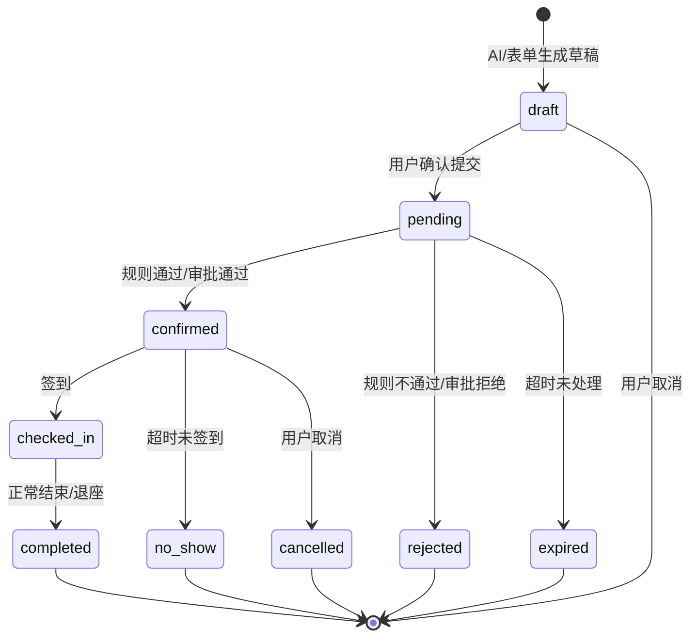
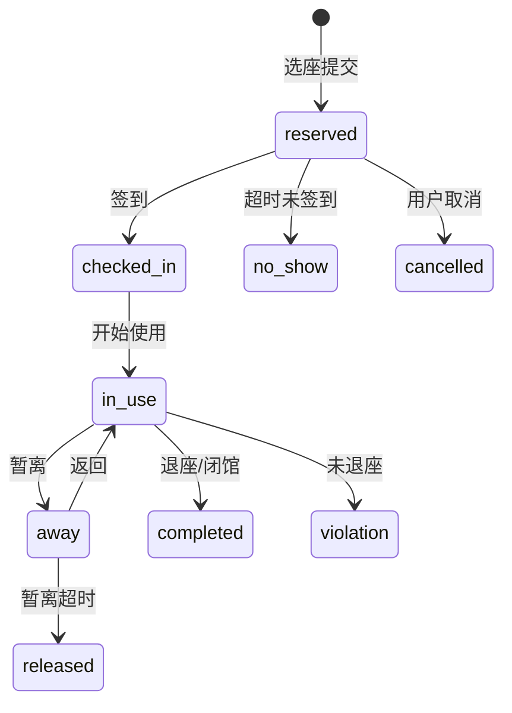
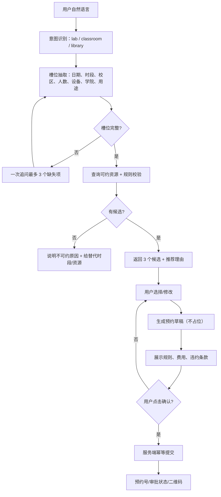
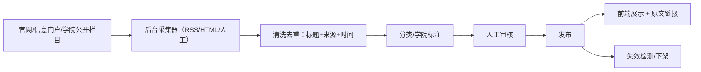
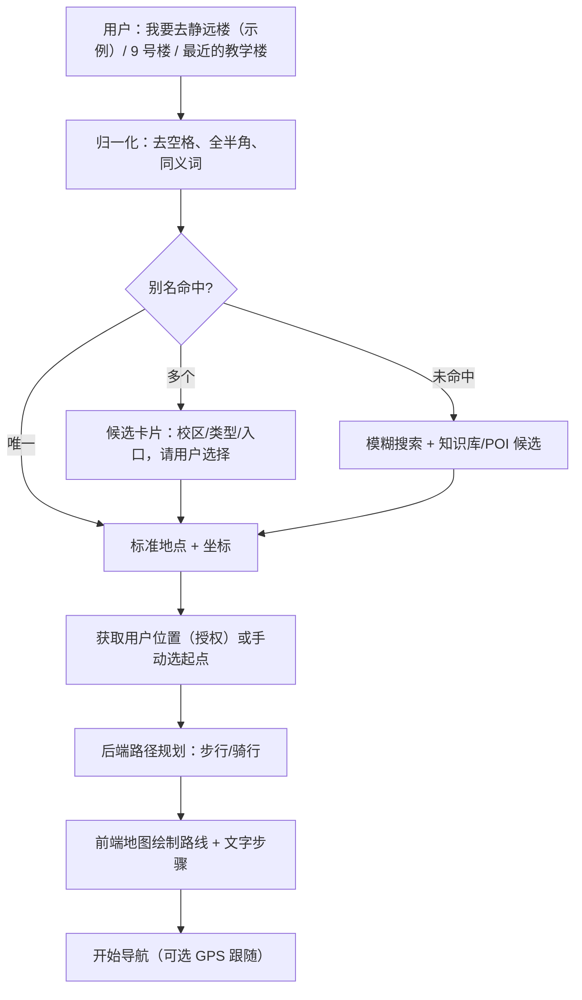
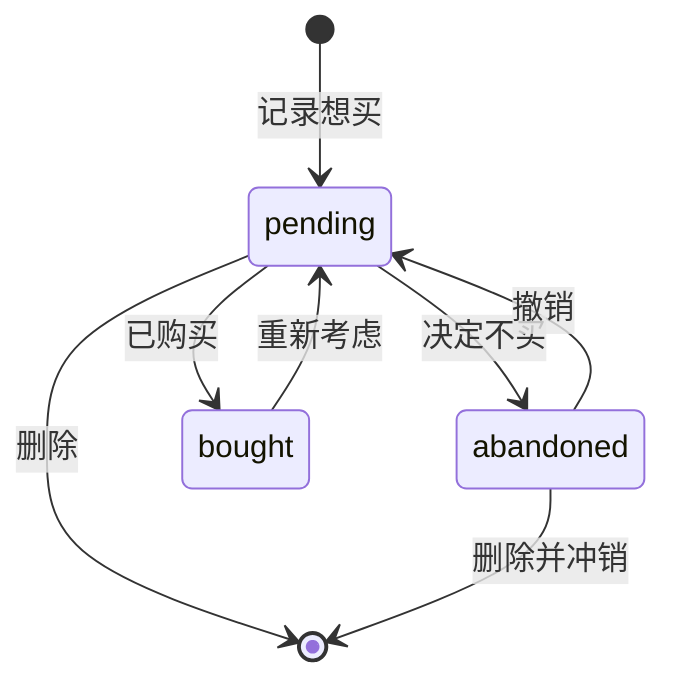
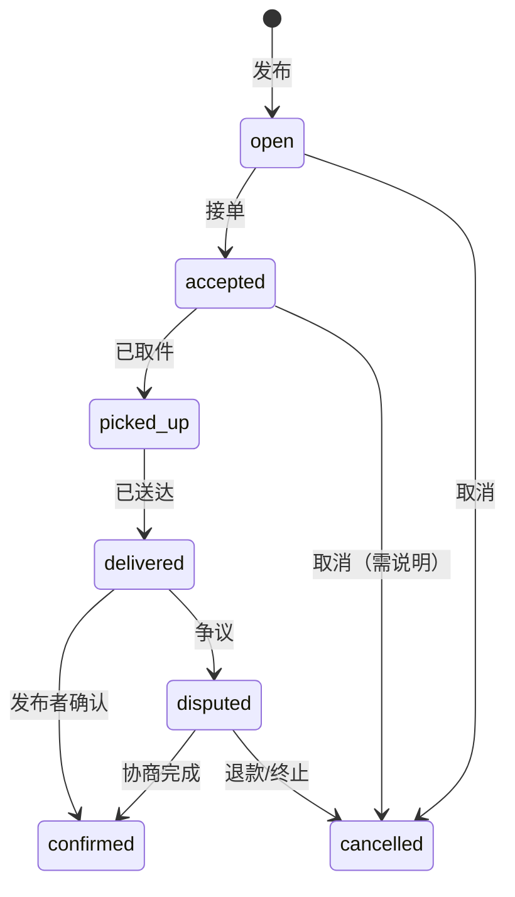
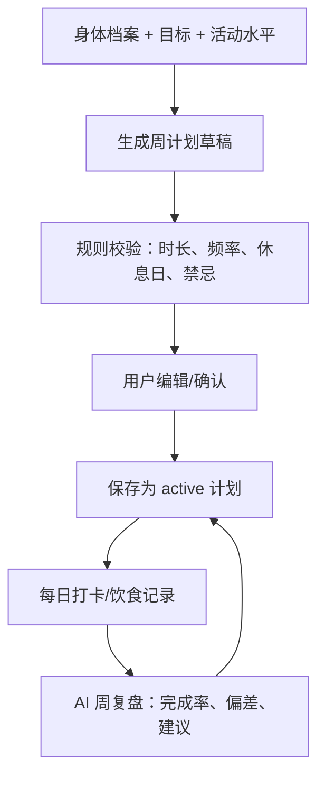
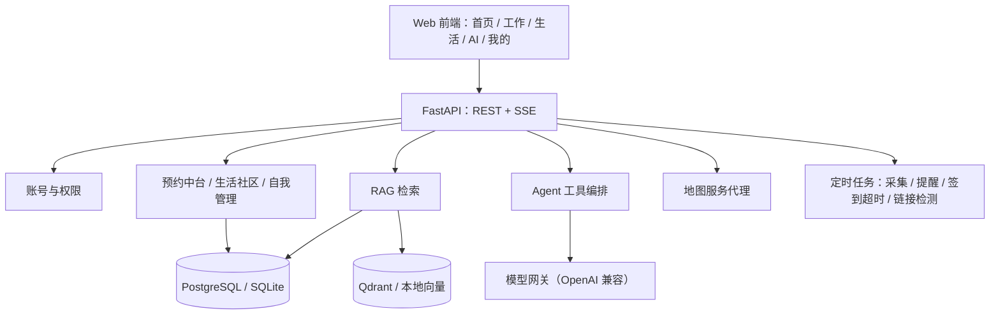

# 苏小师 · 需求分析与完整方案

| 项 | 内容 |
|---|---|
| 文档版本 | v1.1（2026-10-28 增补 Self-Control 自我控制子工作台；v1.0 为 2026-10-27 全量重写） |
| 产品名称 | 苏小师（江苏师范大学校园智慧服务门户） |
| 面向学校 | 江苏师范大学 |
| 面向用户 | 在校本科生、研究生、教师、实验室/教室/图书馆管理员、学校职能部门 |
| 产品结构 | 单首页 + 工作通道 + 生活通道 + 全局 AI 助手 + 个人中心 + 管理后台 |
| 交付形态 | 响应式 Web 应用；RAG + Agent 智能体；预约、导航、社区与自我管理业务闭环 |
| 开发工具 | 华为云码道（AI Coding），按赛事要求保留真实开发过程记录 |
| 文档状态 | 需求与方案基线；文中“待实现”“需授权”“待核验”均表示当前尚未具备该能力 |
| 旧版处理 | v0.6 旧稿已归档至 `docs/archive/需求分析-v0.6-旧版归档.md`，不再作为本产品依据 |

> **本版依据**：用户 2026-10-27 提出的“苏小师”新版需求；江苏师范大学官网、教务处、图书馆、信息门户、数字迎新等公开页面；本地参考案例 `dut-orientation` 的交互与工程做法。
>
> **v1.1 增补**：第 7.5 节由“番茄钟 + 健身 + 计划”扩展为完整的 **Self-Control 自我控制子工作台**（任务/日程/专注/状态/记录/复盘/激励），并同步更新第 4.2 节路由、第 8.4 节工具、第 9.4 节数据模型与第 13 章验收。搭子、省钱、互助仍沿用 7.2–7.4，不重复建设；独立作品形态见 `../../../person`（Self-Control 全栈实现）。
>
> **数据原则**：校情、校历、学院、地址等对外事实只采用官网可核验内容；凡官网未公开或本次无法核验的数值，一律标注“待核验”，不编造。用户上传的两张课表图片未随当前工作目录落盘，本文不据此虚构教室或课程数据。

---

## 0 一页结论：本方案怎么选

| 关键选择 | 结论 | 理由 |
|---|---|---|
| 产品形态 | 单页 Web 应用，桌面固定侧栏 + 移动端底部 Tab | 与参考案例一致的空间层次；单首页避免双主页割裂 |
| 业务结构 | 首页校情总览 + **工作**、**生活** 双通道 | 严格对应用户本次提出的两类使用场景 |
| 预约实现 | **统一预约中台**，实验室、空教室、图书馆共用资源/时段/订单/审批/签到模型 | 三套预约的规则不同但状态机同构，分建三套会导致重复与不一致 |
| 空教室判定 | 以**教务排课数据**为占用源；个人课表只用于“避开我的课” | 单个学生的课表不能推导全校空教室，这是数据边界 |
| AI 接入 | **RAG + Agent 混合**，OpenAI 兼容协议，SSE 流式；写操作必须“推荐→用户确认→幂等提交” | 问答要可溯源，预约不能由模型静默下单 |
| 导航实现 | 后端调用地图服务规划路线，前端内嵌地图绘制；**不跳转高德 App/网页** | 满足“对话后立刻导航、无需手动打开高德” |
| 信息动态 | 聚合官网/信息门户/学院公开栏目，保留标题、摘要、来源、时间，正文跳原文 | 规避全文转载版权风险，保证可追溯 |
| 资源共享 | 分类外链 + 可用性检测 + 登录/网络要求标注 | 学校已有平台不重复建设，门户做“找得到、进得去” |
| 生活社区 | 搭子、省钱、互助共用“帖子 + 标签 + 状态 + 举报”底座，各自扩展 | 复用现有 `posts` 能力，避免三套社区 |
| 健康数据 | 单独授权、最小采集、可导出删除；AI 建议明确非医疗诊断 | 身高体重、饮食、身体信息属敏感个人数据 |
| 首期优先级 | P0：首页、三类预约主流程、导航、搭子、省钱、互助、AI 问答；P1：图书馆座位图/签到、健身 AI、专注计时、订阅；P2：信用体系、智能推荐、跨校资源 | 先保证“能查到、能约到、能走通、能闭环” |

**一句话方案**：把“苏小师”做成一个以校情数据为底座、以预约中台为工作通道核心、以导航/搭子/省钱/互助/自律为生活通道核心、以可溯源 AI 助手贯穿全局的校园服务门户。

---

## 1 项目定位与成功标准

### 1.1 项目定位

“苏小师”面向江苏师范大学全校学生，解决四类高频问题：

1. **校情信息分散**：学校概况、师资成果、校区地址、校历、工作日程散落在官网多个栏目。
2. **校内资源难约**：实验室、空教室、图书馆座位分属不同系统，规则不透明、可约状态不可见。
3. **校园空间难找**：教学楼存在正式名、楼号、口语别名不一致，地图搜不到或定位到错误入口。
4. **校园生活缺连接**：找搭子、判断是否购买、快递代拿、失物招领、自律打卡缺少统一入口。

### 1.2 成功标准

| 维度 | 可验证标准 |
|---|---|
| 信息可信 | 首页每条校情数据可展开查看来源与更新时间；未核验字段不展示猜测值 |
| 预约可用 | 用户能看到“可约/已约/不开放”的真实状态；提交后得到预约号或明确的审批状态 |
| 决策可解释 | AI 推荐资源时给出时间、容量、设备、距离、规则命中理由；不出现无依据的“最合适” |
| 路径可达 | 输入口语楼名后，站内直接展示路线与文字指引，全程不跳转外部地图 |
| 生活闭环 | 搭子/省钱/互助帖子有发布、筛选、响应、关闭、举报的完整状态 |
| 数据安全 | 健康、位置、联系方式等敏感数据最小化采集，本人可导出与删除 |
| 演示可复现 | 固定演示数据 + 真实模型/地图服务状态分别标注，重启后数据保留 |

### 1.3 明确不做

- 不替代学校官方教务、图书馆、实验室管理系统，不伪造“已向学校提交”的状态。
- 不做支付、交易担保、外卖跑腿商业平台、实名社交。
- 不做未经授权的全校课表抓取、图书馆座位系统写入、实验室门禁控制。
- 不提供医疗诊断、心理诊断、就业承诺。
- 不全文转载受版权保护的新闻正文或教材内容。

---

## 2 校情数据基线（官网采集）

> 采集时间：2026-10-27。来源均为江苏师范大学官网公开页面。官网数据会更新，页面必须显示“数据来源 + 更新时间”，以后台维护值为准。

### 2.1 学校概况

| 字段 | 官网值 | 来源 |
|---|---|---|
| 学校全称 | 江苏师范大学（Jiangsu Normal University，JSNU） | 学校简介、章程 |
| 办学性质 | 江苏省人民政府与教育部共建高校；江苏高水平大学建设高校；省属公办本科 | 学校简介、招生章程 |
| 校训 | 崇德厚学，励志敏行 | 学校简介 |
| 校区 | 泉山、云龙、奎园、贾汪（官网页脚同时出现“潘安湖校区”，表述待核验） | 学校简介、页脚 |
| 学院 | 20 个专业学院（部）；另有敬文书院、继续教育学院、国际学院、圣彼得堡彼得大帝理工大学联合工程学院、科文学院 | 学校简介、学院设置 |
| 本科专业 | 66 个本科招生专业 | 学校简介 |
| 学位点 | 2 个一级学科博士点（中国语言文学、数学）；31 个一级学科硕士点；20 个硕士专业学位类别；1 个博士后科研流动站；覆盖 11 个学科门类 | 学校简介 |
| 专任教师 | 1896 人；高级职称 1032 人；博士占比 66.6%；海外研修经历 36.1% | 学校简介（2026-09 更新） |
| 学生规模 | 全日制本科生 25400 余人；博士、硕士研究生 7800 余人；留学生 1000 余人 | 学校简介 |
| 毕业生 | 建校以来向社会输送 35 万余名毕业生 | 学校简介 |
| 占地面积 | **官网《学校简介》《章程》《2026 招生章程》当前公开版本均未给出数值，标注“待核验”** | — |

### 2.2 师资与办学成就（首页“师资成就”展示口径）

| 指标 | 数值 | 展示建议 |
|---|---|---|
| 国家级教学成果奖 | 11 项 | 数据卡 |
| 江苏省教学成果奖 | 73 项 | 数据卡 |
| 国家级一流本科专业建设点 | 24 个 | 数据卡 |
| 国家级特色专业 | 4 个 | 数据卡 |
| 省级一流本科专业建设点 | 16 个 | 数据卡 |
| 国家级一流本科课程 | 34 门 | 成果列表 |
| 国家级实验教学示范中心 | 2 个 | 成果列表 |
| 国家级虚拟仿真实验教学中心 | 1 个 | 成果列表 |
| 国家级虚拟仿真实验教学项目 | 2 个 | 成果列表 |
| 近五年国家级科研项目 | 363 项（国家社科 160 项、国家自科 203 项） | 成果列表 |
| 国家杰青 / 优青 | 1 项 / 2 项（近五年） | 师资成就 |
| ESI 全球前 1% 学科 | 9 个：化学、工程学、材料科学、数学、社会科学总论、计算机科学、植物与动物科学、农业科学、环境/生态学 | 学科矩阵 |
| 2025 软科中国最好学科 | 10 个学科入榜；中国语言文学进入前 12% | 学科矩阵 |
| 部省级科研平台 | 43 个 | 成果列表 |

代表性人物/团队展示：优先使用官网“出彩师大人”“名师风采”等公开栏目，取得授权后展示姓名、简介与原文链接；未获授权时只展示指标与成果，不使用未经许可的肖像与个人资料。

### 2.3 四校区与地址

| 校区 | 地址 | 邮编 | 备注 |
|---|---|---|---|
| 泉山校区 | 江苏省徐州市铜山新区上海路 101 号 | 221116 | 主校区；章程法定住所 |
| 云龙校区 | 江苏省徐州市云龙区和平路 57 号 | 221009 | 招生章程列示 |
| 奎园校区 | 江苏省徐州市泉山区解放南路 | 221009 | 官网页脚 |
| 潘安湖校区 | 江苏省徐州市潘安湖科教创新区学院路 1 号 | 221132 | 官网页脚；简介称“贾汪”，待核验 |

### 2.4 2026-2027 学年校历（教务处 2026-05-28 发布）

> 来源：江苏师范大学教务处《江苏师范大学2026-2027学年校历》。以下日期由校历图片识别整理，**考试周与部分调休为识别推断，入库前须由教务处复核**。

| 项目 | 第一学期 | 第二学期 |
|---|---|---|
| 教职工报到 | 2026-09-05 | 2027-02-27 |
| 学生报到/注册 | 2026-09-06 | 2027-02-28 |
| 正式上课 | 2026-09-07（周一） | 2027-03-01（周一） |
| 学期结束 | 2027-01-17（周日） | 2027-07-04（周日） |
| 教学周数 | 19 周 | 18 周 |
| 期末考试周（待核验） | 第 18–19 周（2027-01-04 至 01-17） | 第 17–18 周（2027-06-21 至 07-04） |
| 寒假 | 2027-01-16 至 2027-02-28 | — |
| 暑假 | — | 2027-07-05 起 |
| 主要假期 | 国庆/中秋 2026-10-01 至 10-08；元旦 1 天 | 清明、劳动节、青年节（半天，不停课）、端午 |

### 2.5 作息时间（校历附图）

| 大节 | 小节 | 时间 |
|---|---|---|
| 第一大节 | 1 / 2 | 08:00–08:40 / 08:45–09:25 |
| 第二大节 | 3 / 4 / 5 | 09:45–10:25 / 10:30–11:10 / 11:15–11:55 |
| 第三大节 | 6 / 7 | 14:00–14:40 / 14:45–15:25 |
| 第四大节 | 8 / 9 | 15:45–16:25 / 16:30–17:10 |
| 第五大节 | 10 / 11 / 12 | 18:30–19:10 / 19:15–19:55 / 20:00–20:40 |

该作息表用于：课表时间轴、空教室时段、实验室“工作时间”判定、图书馆闭馆提醒、专注计时默认时段。

### 2.6 学院清单（用于信息动态分学院、实验室面向学院、课表共享）

文学院、语言科学与艺术学院、历史文化与公共管理学院、法学院、马克思主义学院、外国语学院、教育学部、数学与统计学院、物理与光电工程学院、化学与分子工程学院、生命科学与食品工程学院、地理与空间信息学院、体育与健康学院（足球学院）、艺术学部（美育中心）、商学院、江苏圣理工学院－中俄学院、人工智能与计算机学院、机械工程学院（智能制造学院）、电气工程与自动化学院、未来技术学院、敬文书院、科文学院。

> 信息动态的“分学院”以前 20 个专业学院为主，敬文书院/科文学院单独分组；学院名称变更时后台可维护，不在前端写死。

---

## 3 用户、角色与核心场景

### 3.1 角色

| 角色 | 核心诉求 | 权限 |
|---|---|---|
| 访客 | 看校情、校历、公开动态、资源链接 | 只读公开内容；预约/发帖/健康档案需登录 |
| 学生 | 预约资源、找路线、找搭子、省钱、互助、自律 | 本人预约、本人帖子、本人健康数据 |
| 教师 | 查看/申请实验室、教室，查看校历与动态 | 教师预约规则可配置；不默认拥有管理权限 |
| 资源管理员 | 维护实验室、教室、座位、开放规则、审批 | 所辖资源的管理与审批 |
| 信息管理员 | 维护校情、校历、工作日程、信息动态、资源链接 | 内容发布与下架 |
| 系统管理员 | 账号、权限、审计、模型与地图配置 | 全局；密钥不可回显 |

角色与身份分开建模：本科生/研究生是画像，学生/教师/管理员是权限，学院/校区是归属。画像只影响默认内容，不改变权限。

### 3.2 核心用户故事

| 编号 | 用户故事 | 成功结果 |
|---|---|---|
| US-01 | 作为新生，我想在一页看懂学校概况、校区、校历和本周安排 | 首页数据有来源，校历可切学期，本周日程可展开 |
| US-02 | 作为学生，我想知道明天下午哪些实验室能约 | 看到实验室地点、设备、面向学院、可约时段与不开放原因 |
| US-03 | 作为学生，我想借一间没课的教室开小组讨论 | 系统避开排课与已审批占用，提交后显示审批状态 |
| US-04 | 作为学生，我想约图书馆座位并按时签到 | 选座→预约→签到→暂离→完成，违约规则可见 |
| US-05 | 作为学生，我想一句话让 AI 帮我约到合适资源 | AI 追问缺失条件，给出候选与理由，确认后下单 |
| US-06 | 作为学生，我想说“去静远楼”（示例，待核验）就能看到路线 | 别名解析成功，站内地图绘制路线，不跳转高德 |
| US-07 | 作为学生，我想找学习/运动/摄影搭子 | 按标签、时间、校区筛选，看到匹配理由与帖子状态 |
| US-08 | 作为学生，我想发一个“想买的东西”让大家投票 | 帖子展示投票分布，个人决策与省钱统计分开 |
| US-09 | 作为学生，我想发快递代拿或失物招领 | 状态可流转，联系方式脱敏，可举报与关闭 |
| US-10 | 作为学生，我想用专注计时、饮食记录和健身计划自律 | 计时、打卡、AI 分析、计划与提醒形成闭环 |
| US-11 | 作为管理员，我想更新一条过期校历或下架错误动态 | 更新有版本与审计，前端立即生效 |
| US-12 | 作为资源管理员，我想批量导入实验室/教室/座位与开放规则 | 导入有预览、校验、失败回滚与样例标记 |

---

## 4 信息架构与导航

### 4.1 一级导航

固定五项：**首页 / 工作 / 生活 / AI 助手 / 我的**。管理后台为独立入口，不混入学生导航。



### 4.2 路由与页面清单

| 路由 | 页面 | 主体内容 | 主要操作 |
|---|---|---|---|
| `/` | 首页 | 校情、师资成就、校区地址、本周日程、校历、动态、快捷入口 | 查看、切换学期、进入通道、提问 |
| `/work` | 工作概览 | 三类预约入口、今日可约摘要、资源链接、动态 | 快速进入预约/资源/动态 |
| `/work/booking` | 预约中心 | 我的预约、可约资源、规则说明 | 筛选、预约、取消、签到 |
| `/work/booking/lab` | 实验室预约 | 实验室列表、设备、面向学院、时段矩阵 | 筛选、选时段、提交审批 |
| `/work/booking/classroom` | 空教室预约 | 教室列表、排课占用、可约时段 | 选教室/时段、提交申请 |
| `/work/booking/library` | 图书馆预约 | 馆区/楼层/座位图、时段、签到 | 选座、签到、暂离、退座 |
| `/work/resources` | 资源共享 | 分类外链、适用人群、网络要求、可用性 | 打开外链、反馈失效 |
| `/work/news` | 信息动态 | 分类/学院筛选、滚轮卡片、详情抽屉 | 筛选、订阅、查看原文 |
| `/life` | 生活概览 | 导航、搭子、省钱、互助、自我管理入口 | 进入子功能 |
| `/life/nav` | 校园导航 | 搜索、别名候选、地图、路线、步骤 | 搜索、选候选、开始导航 |
| `/life/buddy` | 搭子 | 标签筛选、帖子流、发布、我的搭子 | 发布、响应、关闭、举报 |
| `/life/deal` | 省钱 | 想买帖子、投票、个人决策、统计 | 发布、投票、改状态 |
| `/life/help` | 互帮互助 | 代拿、失物招领、求助 | 发布、接单、确认、认领 |
| `/life/self` | 自我管理 | 专注计时、任务/日程、状态打卡、记录箱、论文、复盘、成就、健身打卡、饮食、提醒 | 计时、记录、生成计划、设置提醒 |
| `/life/self/today` | 自我管理·今日 | 状态、今日任务、日程、专注、助理建议 | 打卡、勾任务、开始专注 |
| `/life/self/plan` | 计划 | 收件箱/今天/本周、消息转待办 | 建任务、排期、顺延 |
| `/life/self/focus` | 专注 | 计时、背景音、周统计、热力图 | 开始/暂停/结束 |
| `/life/self/records` | 记录 | 随记、图片、待整理、转任务 | 记一笔、分类、转任务 |
| `/life/self/papers` | 论文 | 阶段、卡点、下一步、时间线 | 推进、编辑、转任务 |
| `/life/self/review` | 复盘 | 周统计、洞察、三条重点 | 起草、编辑、保存 |
| `/life/self/achievements` | 成就 | 徽章、等级、积分、皮肤 | 兑换、切换 |
| `/assistant` | AI 助手 | 会话、工具轨迹、引用、业务卡片 | 提问、追问、确认写操作、停止 |
| `/me` | 我的 | 预约、帖子、健康档案、收藏、设置 | 查看、编辑、导出、删除 |
| `/admin` | 管理后台 | 校情/校历、资源、动态、链接、审核、审计 | 维护、导入、审批、下架 |

### 4.3 导航规则

- 工作/生活切换保留各自筛选、滚动位置和未提交草稿。
- 直接访问链接以链接为准，不强制跳回上次通道。
- 未登录时公开页可读；点击预约、发帖、健康档案时弹出登录并保留原操作意图。
- P1/P2 未上线功能不显示可点击空壳；规划项必须标“即将开放”。

---

## 5 首页需求

### 5.1 首页目标

用户进入后 10 秒内知道：**这是什么学校、有哪些校区、这周是什么教学周、现在能做什么**。首页不是功能堆叠页，而是“校情 + 日程 + 入口”。

### 5.2 页面结构

```text
┌────────────┬──────────────────────────────────────────────────┐
│ 苏小师      │ 首页                         校区  搜索  头像     │
│ 首页        ├──────────────────────────────────────────────────┤
│ 工作        │ Hero：江苏师范大学 · 崇德厚学 励志敏行             │
│ 生活        │ 2026-2027 第一学期 · 第 N 周 · 今日日程摘要        │
│ AI 助手     │ [一句话提问：明天下午哪里能自习？]                 │
│ 我的        ├──────────────────────────────────────────────────┤
│            │ 数据卡：4 校区 / 20 学院 / 66 专业 / 1896 教师      │
│            │ 师资成就：教学成果、一流专业、ESI、软科              │
│            ├───────────────────────────┬──────────────────────┤
│            │ 本周工作日程               │ 校历（月/周切换）     │
│            │ 教学周、假期、考试、活动   │ 今日高亮、事件标记    │
│            ├───────────────────────────┴──────────────────────┤
│            │ 四校区地址卡 + [查看地图/导航]                      │
│            ├──────────────────────────────────────────────────┤
│            │ 快捷入口：预约｜导航｜搭子｜省钱｜互助｜自律          │
│            ├──────────────────────────────────────────────────┤
│            │ 信息动态滚动区（分类/学院）        [查看全部]        │
└────────────┴──────────────────────────────────────────────────┘
```

### 5.3 功能需求

| 编号 | 功能 | 规则与输出 | 优先级 |
|---|---|---|---|
| HOME-01 | 校情 Hero | 校名、校训、当前学期/教学周、今日日期；背景图使用已授权校园素材 | P0 |
| HOME-02 | 关键数据卡 | 4 校区、20 学院、66 本科专业、1896 专任教师、25400 本科生、9 个 ESI 前 1%；每项可点开来源 | P0 |
| HOME-03 | 师资成就 | 指标卡 + 代表性成果列表；不展示未经授权的个人肖像 | P0 |
| HOME-04 | 校区与地址 | 四校区地址、邮编、地图入口；含“占地面积”字段，官网未公开时显示“待校方提供”；潘安湖/贾汪表述标注待核验 | P0 |
| HOME-05 | 本周工作日程 | 教学周、节假日/调休、考试周、校级活动、预约截止；按日期分组 | P0 |
| HOME-06 | 校历 | 学期切换、月视图/周次视图、今日高亮、事件图例；支持下载原图/原文链接 | P0 |
| HOME-07 | 信息动态摘要 | 最新 6–8 条，分类与学院标签，滚动展示，点击进详情 | P0 |
| HOME-08 | 快捷入口 | 六类生活/工作入口，带当前状态（如“本周 3 个可约时段”） | P0 |
| HOME-09 | 全局提问框 | 输入问题进入 AI 助手，携带来源页上下文 | P0 |
| HOME-10 | 数据来源与更新时间 | 每个数据区块底部显示来源与更新时间 | P0 |
| HOME-11 | 个性化 | 登录后显示“我的下一节课/我的预约/我的打卡”；可关闭 | P1 |

### 5.4 首页数据规则

- 所有数值来自后端 `school_profile` / `school_metrics`，前端不写死；后台修改后首页刷新即生效。
- 占地面积字段保留，但值为空时显示“待校方提供”，**不得显示猜测数字**。
- 校区名称以官网最新表述为准；贾汪/潘安湖冲突时同时保留并标注“以学校最新公布为准”。
- 校历事件区分 `confirmed`（教务处原文）与 `inferred`（图片识别推断），后者在详情中标注。
- 首页动态只显示已审核公开条目；不展示需登录的信息门户内容。

### 5.5 首页验收要点

- 断网/接口失败时，校情与校历展示最近一次缓存并标注“缓存时间”，不白屏。
- 375px 宽度下数据卡变 2 列，校历横向滚动仅发生在日历容器内。
- 点击任一数据卡可看到来源链接与更新时间。

---

## 6 工作通道

工作通道三个主功能：**预约中心、资源共享、信息动态**。

### 6.1 预约中心总览

#### 6.1.1 统一预约模型

三类预约共用：资源（resource）、可约时段（slot）、预约单（booking）、审批（approval）、签到（checkin）、违约（violation）。



#### 6.1.2 通用规则

| 规则 | 说明 |
|---|---|
| 时间口径 | 统一 Asia/Shanghai；时段以 5 分钟为粒度；跨天预约拆分为多段 |
| 防超卖 | 数据库对 `(resource_id, slot_start, slot_end)` 建唯一约束；提交时事务校验 |
| 幂等 | 客户端传 `Idempotency-Key`；重复提交返回同一预约单，不重复占位 |
| 审批 | 需审批的资源先占“待审额度”，审批拒绝立即释放；超时自动过期 |
| 取消 | 开始前可取消；开始后不可取消，按违约处理；规则按资源类型配置 |
| 冲突 | 同一用户同一时段只能有一个有效预约（可配置允许多个） |
| 权限 | 学院受限资源校验用户学院；教师/学生规则分开 |
| 审计 | 创建、审批、取消、签到、违约全部留操作日志 |
| 展示 | “可约/已约/不开放/待审批/已满”五态必须区分，不能用同一颜色 |

#### 6.1.3 预约中心页面

- 顶部：我的预约（待审批/已确认/待签到/历史）、今日可约摘要。
- 中部：三类资源卡片，显示开放状态、剩余时段、规则摘要。
- 右侧/抽屉：规则说明、违约条款、常见问题。
- 空态：无预约时给“去约实验室/教室/座位”的下一步。
- 失败态：区分“无权限”“时段冲突”“超出可约天数”“资源未开放”“系统未授权”。

### 6.2 实验室预约

#### 6.2.1 资源字段

| 字段 | 说明 |
|---|---|
| 实验室名称 | 正式名称，如“XX 实验室” |
| 所属学院/单位 | 用于“面向学院”判定 |
| 校区/楼栋/房间 | 标准地点 + 别名，支持导航 |
| 实验室类型 | 教学/科研/创新/公共 |
| 作用简介 | 一句话说明能做什么 |
| 设备清单 | 设备名、型号、数量、状态（可用/维修） |
| 资源能力 | 工位/机位数、可容纳人数、软件环境 |
| 面向对象 | 本学院学生/全校/公开（需审核） |
| 开放规则 | 工作日工作时间、可提前天数、单次时长、每周次数 |
| 安全要求 | 安全考试、教师陪同、着装要求、需自备材料 |
| 管理员 | 审批人/联系方式（站内） |
| 来源/核验 | 数据来源、核验人、核验时间 |

#### 6.2.2 可约判定

实验室可约 = 资源启用 ∧ 在开放日 ∧ 在开放时段 ∧ 未超提前/延后限制 ∧ 无已确认预约 ∧ 用户符合面向对象 ∧ 满足安全前置条件。

- **开放时间**：默认工作日 08:00–17:10（按作息），可配置午休与晚间；周末/节假日默认不开放，除非管理员单独开放。
- **不可约原因必须可见**：非工作日、非开放时段、非面向学院、需安全考试、设备维修、已被预约、超出提前天数、超出每周次数。
- **审批**：提交后状态为“待审批”，管理员在后台看到申请人、用途、人数、设备需求、安全条件；通过后发预约号与签到二维码。
- **名额**：按工位/机位计算，多人预约需填写人数，人数不得超过容量。
- **冲突**：同一实验室同一时段唯一；同一设备被多个实验室共享时，设备也要占用校验。

#### 6.2.3 页面

```text
┌──────────────────────────────────────────────────────────────┐
│ 实验室预约   [校区▾] [学院▾] [类型▾] [只看可约]   搜索        │
├──────────────────────────────────────────────────────────────┤
│ 今日可约 12 间 · 本周可约 38 个时段                          │
│ ┌───────────────┐ ┌───────────────┐ ┌───────────────┐        │
│ │ 实验室 A       │ │ 实验室 B       │ │ 实验室 C       │        │
│ │ 地点 · 容量    │ │ 地点 · 容量    │ │ 地点 · 容量    │        │
│ │ 设备标签       │ │ 设备标签       │ │ 设备标签       │        │
│ │ 面向：本学院   │ │ 面向：全校     │ │ 今日不开放     │        │
│ │ [查看时段]     │ │ [查看时段]     │ │ 原因：周末     │        │
│ └───────────────┘ └───────────────┘ └───────────────┘        │
├──────────────────────────────────────────────────────────────┤
│ 时段矩阵：08:00 09:00 10:00 … 17:00                          │
│ 可约=绿 已约=灰 不开放=斜线 待审批=黄                          │
│ 右侧抽屉：设备、规则、安全要求、[提交预约]                     │
└──────────────────────────────────────────────────────────────┘
```

#### 6.2.4 验收

- 非工作日/非工作时间无法提交，且提示具体原因。
- 非目标学院学生看到“仅面向 XX 学院”，不可提交。
- 同一时段并发提交只成功一单；第二单返回冲突。
- 设备维修时该设备不可选，或实验室整体不可约。
- 审批拒绝后释放时段，用户可以重新选择。

### 6.3 空教室预约

#### 6.3.1 数据边界（关键）

空教室数据由三部分组成：

1. **教室主数据**：校区、楼栋、房间号、容量、类型（普通/多媒体/研讨/机房）、设备、开放借用状态。
2. **排课占用**：教务处课表导入的课程占用（学期、周次、星期、节次、教室）。
3. **临时占用**：考试、活动、维修、已审批借用。

> 单个学生的个人课表**不能**用于推导全校空教室。个人课表只用于“避开我自己的课”。用户上传的课表图片若仅用于个人课表，不进入空教室占用源。

#### 6.3.2 用户上传课表图片

用户本次提供了两张课表图片（文件名以 `c934ceee…`、`b3b65309…` 开头），但当前工作目录未找到文件。方案定义如下流程，待图片重新上传后执行：

1. 上传 PNG/JPG/PDF/Excel，单文件 ≤10MB。
2. 建立解析任务：图片走 OCR/视觉模型；表格优先确定性解析。
3. 输出结构化预览：课程名、教师、星期、节次、周次、单双周、教室。
4. 标记缺失/冲突/低置信度字段；用户逐项确认。
5. 确认后保存为个人课表；解析草稿不生效。
6. 个人课表用于：今日课程、避开我的课、空教室推荐时排除我的上课时段。

#### 6.3.3 可约判定

空教室可约 = 教室开放借用 ∧ 目标时段无排课 ∧ 无临时占用 ∧ 无已审批借用 ∧ 未超出可约天数 ∧ 用户无冲突预约。

- 默认只开放**非教学时段**（工作日 18:30–20:40、周末 08:00–20:40），具体以教务处规则为准。
- 教室借用需审批：申请用途、人数、设备、责任人；通过后生成借用单。
- 不得用于商业培训、收费活动、校外人员活动。
- 教室容量不足时禁止提交；需要多媒体设备时只显示具备设备的教室。
- 排课数据未覆盖的学期/周次，页面必须显示“数据未覆盖”，不能当作空闲。

#### 6.3.4 页面

- 筛选：校区、楼栋、日期、时段、容量、教室类型、设备。
- 列表/矩阵双视图：列表看教室详情；矩阵看时段占用。
- 占用图例：排课占用、临时占用、已审批、可预约、数据未覆盖。
- 教室详情：照片（授权）、容量、设备、位置、导航入口、规则。
- 提交：用途、人数、联系人、是否需要投影/话筒、备注；提交后显示审批流。

#### 6.3.5 验收

- 有排课的时段显示“已占用（课程）”，不可选。
- 数据未覆盖的周次显示“数据未覆盖”，不可选。
- 同一教室并发申请只成功一单。
- 审批通过后，占用立即反映到其他用户的矩阵。
- 个人课表导入后，“避开我的课”能正确排除对应时段。

### 6.4 图书馆预约

#### 6.4.1 功能范围

参考主流高校图书馆座位预约平台的完整闭环：

1. 选馆区/楼层/区域（自习区、研讨间、电子阅览区）。
2. 座位地图：座位号、类型（普通/靠窗/电源/研讨）、状态（可约/已约/在用/暂离/维修）。
3. 选择日期与时段（当日/次日，按馆区规则）。
4. 提交预约，获得预约码/二维码。
5. 到馆签到：扫码签到或定位签到（以图书馆规则为准）。
6. 暂离：保留座位 30 分钟（可配置），超时释放。
7. 退座/完成：主动释放座位。
8. 违约：未签到、暂离超时、未退座；累计违约冻结预约权限。
9. 我的预约：待签到、使用中、历史、违约记录。

#### 6.4.2 状态机



#### 6.4.3 规则

| 规则 | 默认值（可配置） |
|---|---|
| 可约范围 | 当日 + 次日 |
| 单次时长 | 2 小时，可续约 1 次 |
| 签到时限 | 预约开始后 15 分钟内 |
| 暂离时长 | 30 分钟 |
| 违约阈值 | 7 天内 3 次，冻结 7 天 |
| 同时有效预约 | 1 个 |
| 座位释放 | 闭馆前 30 分钟提醒 |

#### 6.4.4 数据与接口边界

图书馆座位系统通常由图书馆现有平台（如超星/自有系统）管理。本产品分两种接入模式：

- **A 模式（推荐）**：图书馆开放座位查询/预约/签到接口，本产品做统一入口与 AI 推荐。
- **B 模式**：无接口时，本产品只做“座位导览 + 预约规则说明 + 跳转图书馆官方预约入口”，**不伪造预约成功**。

首期验收至少完成 B 模式；A 模式需图书馆书面授权与接口联调。

#### 6.4.5 验收

- 座位图状态与后端一致；已被预约座位不可重复选择。
- 签到超时自动转 `no_show` 并释放座位。
- 暂离超时自动释放；返回后恢复使用。
- 违约累计与冻结生效；解冻时间可见。
- B 模式下明确标注“将前往图书馆官方系统”，不显示站内预约号。

### 6.5 预约 AI 助手

#### 6.5.1 支持的说法

- “明天下午三点帮我约一个能坐 6 个人、有投影的研讨室。”
- “周三晚上哪里有空教室，我们四个人讨论。”
- “帮我找一个今天下午有电源的图书馆座位。”
- “这周还有哪些实验室能约？”

#### 6.5.2 处理流程



#### 6.5.3 硬性约束

- AI 不得自行提交预约；必须有一次明确的“确认预约”点击。
- AI 不得编造资源、时段、设备、容量、预约号。
- 推荐理由必须来自结构化字段（时间匹配、容量、设备、距离、规则命中），不能只说“最合适”。
- 查询无结果时，返回“没有满足条件的资源”，并给出放宽条件的建议（换时段/换校区/减少人数）。
- 写操作使用一次性确认令牌，绑定用户、资源、时段、草稿版本；草稿过期需重新确认。

### 6.6 资源共享

#### 6.6.1 定位

不重复建设学校已有平台，做“分类导航 + 适用说明 + 可用性检测 + 失效反馈”。

#### 6.6.2 分类与首批链接

| 分类 | 名称 | 链接 | 说明 | 状态 |
|---|---|---|---|---|
| 实验教学 | 信息类专业实验教学一体化平台 | https://cstlab.jsnu.edu.cn/indexcs/simple.jsp | CourseGrading 实验/评测平台，需登录 | 首页可达；登录后功能未验证 |
| AI 平台 | 江苏师范大学大模型广场 | https://model.jsnu.edu.cn/ | 统一 AI API 网关/控制台 | 首页可达；账号与额度未验证 |
| 实践教学 | 江苏师范大学实践教学平台 | https://jsnu.eduplus.net/home/index | 实践教学相关 | 官网入口 |
| 图书资源 | 江苏师范大学图书馆 | https://lib.jsnu.edu.cn/ | 馆藏、借阅、数据库 | 官网入口 |
| 信息门户 | 校园信息门户 | https://i.jsnu.edu.cn/ | 通知、待办、校园身份 | 需登录 |
| 教务 | 教务系统 | 官网“教务系统”快速链接 | 课表、成绩、选课 | 需登录 |
| 迎新 | 数字迎新 | http://welcome.jsnu.edu.cn/ | 新生报到、校园信息 | 公开 |
| 招生 | 本科招生网 | http://bkzs.jsnu.edu.cn/ | 招生章程、专业 | 公开 |
| 就业 | 就业创业信息网 | http://jsnu.91job.org.cn/ | 招聘、就业指导 | 公开/登录 |
| 新闻 | 江苏师范大学新闻网 | http://www.jsnu.edu.cn/news/list.htm | 校内新闻 | 公开 |
| 全景 | 泉山校区全景 | https://www.720yun.com/t/79ajOzhvkv8 | 校园全景导览 | 公开 |

> 链接入库时必须记录：名称、URL、分类、适用对象、是否需登录、是否需校园网/VPN、来源、最后验证时间、验证结果。外链打开前提示“将离开苏小师”。

#### 6.6.3 功能需求

| 编号 | 功能 | 规则 | 优先级 |
|---|---|---|---|
| RES-01 | 分类浏览 | 实验/AI/图书/教务/迎新/就业/新闻等；支持搜索 | P0 |
| RES-02 | 外链卡片 | 名称、简介、适用人群、登录要求、网络要求、最后验证时间 | P0 |
| RES-03 | 可用性检测 | 后台定时探测 HTTP 状态；失败标“可能不可用”，不直接删除 | P1 |
| RES-04 | 失效反馈 | 用户可反馈“打不开/需权限”，管理员处理 | P1 |
| RES-05 | 使用说明 | 首次使用提示登录方式、校园网要求、常见问题 | P0 |
| RES-06 | 安全提示 | 外部链接新窗口打开，`rel=noopener`；不携带站内 token | P0 |

### 6.7 信息动态

#### 6.7.1 参考与定位

参考江苏师范大学信息门户（i.jsnu.edu.cn）的公告组织方式：分类、分组、订阅、已读状态。本产品做“公开信息聚合 + 分类分学院 + 滚轮浏览”，不替代信息门户的待办与公文流转。

#### 6.7.2 分类

- 通知公告
- 学术科研
- 校园活动
- 就业实习
- 学院动态
- 媒体聚焦
- 招标采购（可选）
- 系统公告（本产品维护）

学院维度：20 个专业学院 + 敬文书院 + 科文学院 + 职能部门。

#### 6.7.3 展示

- 顶部：分类 Tab + 学院筛选 + 时间范围 + 搜索。
- 主区：滚轮式卡片流（横向滚轮/纵向滚动，桌面支持鼠标滚轮切换分组）。
- 卡片：标题、摘要（≤80 字）、来源、发布时间、分类/学院标签、缩略图（授权）。
- 详情抽屉：标题、来源、发布时间、摘要、原文链接、相关推荐。
- 订阅：登录用户可订阅分类/学院；站内消息汇总；不承诺实时推送。
- 已读：记录已读状态，支持“只看未读”。

#### 6.7.4 采集与版权



- 只存标题、摘要、来源、发布时间、原文链接；正文跳原文。
- 不采集需登录/需授权的内容；不绕过反爬与访问控制。
- 采集频率可配置；同一来源去重；原文失效时标记“来源已失效”，不删除历史记录。
- 每条动态必须显示来源；无来源的条目不得发布。

#### 6.7.5 验收

- 分类/学院筛选结果正确，空结果有提示。
- 卡片滚动不触发页面整体横向滚动。
- 详情能打开原文；外链新窗口。
- 后台下架后前端立即不可见。
- 未审核条目不出现在前台。

---

## 7 生活通道

### 7.1 校园导航

#### 7.1.1 要解决的问题

教学楼/实验楼在学校内部有正式名、楼栋号、学生口语别名；高德地图可能只收录其中一种，导致搜不到或定位到错误入口。产品需要：

1. 建立**地点别名库**：标准名、别名、楼号、校区、坐标、入口说明、来源、核验状态。
2. 用户说口语名，系统解析到标准地点。
3. 站内直接规划并展示路线，不跳转高德。

#### 7.1.2 别名库字段

| 字段 | 说明 |
|---|---|
| 标准名称 | 学校正式名称 |
| 别名 | 学生常用叫法、楼号、简称 |
| 校区 | 泉山/云龙/奎园/潘安湖 |
| 类型 | 教学楼/实验楼/食堂/宿舍/图书馆/校门/运动场/服务点 |
| 坐标 | GCJ-02 经纬度（高德坐标系） |
| POI ID | 地图服务商 POI ID（若有） |
| 入口描述 | “从东门进，直行 200 米，右侧” |
| 来源 | 官网/全景/实地/用户反馈 |
| 核验状态 | 待核验/已核验/有争议 |
| 核验人/时间 | 责任追溯 |

首批数据来源：官网校区地址、720 全景场景名（21 世纪大楼、科文学院、电气学院、钟楼、东门、一食堂、三食堂等）、用户提供清单、实地核验。**未核验的别名不进入正式导航**，可在“纠错”中展示。

#### 7.1.3 导航流程



#### 7.1.4 交互要求

- 支持输入：“去静远楼”（示例，待核验）“9 号楼怎么走”“从图书馆到某教学楼”“离我最近的自习教室”。
- 多候选时先问校区，不擅自选一个。
- 路线面板展示：总距离、预计时间、步行步骤、关键路口、目的地入口照片（授权）。
- 地图默认站内展示；**不自动跳转高德**。提供“在高德中打开”作为可选次级操作。
- 定位权限被拒绝时，允许手动选择起点（校门/教学楼/当前位置描述）。
- 地图服务不可用时，降级为文字地址 + 入口说明 + 静态示意图，并标注“路线服务暂不可用”。

#### 7.1.5 地图服务方案

| 方案 | 做法 | 取舍 |
|---|---|---|
| 高德 Web 服务 API + 前端地图 | 后端代理路径规划/地理编码，前端用高德 JS API 绘制 | 推荐；需 key、配额、域名白名单 |
| 高德 JS API 直连 | 前端直接调用 | 不推荐；key 暴露、配额不可控 |
| 静态地图 + 文字步骤 | 无 key 时兜底 | 可用但体验弱 |
| 自建瓦片 | 成本高 | 不采用 |

密钥只放后端；前端通过短时 token/代理访问；按 IP/域名/接口做限额；日志不记录 key。

#### 7.1.6 验收

- 输入已核验别名能唯一解析；输入未核验别名提示“待核验”，不导航到错误地点。
- 同名多校区时出现候选，不自动选择。
- 路线在站内绘制，全程不离开本站。
- 拒绝定位后可手动选起点并规划。
- 地图服务失败时给出可执行的替代信息。

### 7.2 搭子

#### 7.2.1 类型

学习搭子、考研搭子、运动搭子、摄影搭子、饭搭子、游戏搭子、观展搭子、徒步搭子。类型可后台维护，前端不写死数量。

#### 7.2.2 帖子字段

| 字段 | 说明 |
|---|---|
| 类型 | 上述标签，可多选（1–3 个） |
| 状态短帖 | 支持“一句话状态（≤200 字）+ 标签 + 时间/地点”的轻量发布；标题可选 |
| 标题/说明 | 想找什么样的搭子、目的、期望 |
| 时间 | 具体时间或时间范围 |
| 地点 | 校区 + 标准地点（可空） |
| 人数 | 1–N |
| 联系方式 | 站内私信默认；其他方式需用户主动填写并提示风险 |
| 状态 | open / matched / closed / removed |
| 举报 | 先发后举报；管理员可下架 |

#### 7.2.3 匹配与展示

- 筛选：类型、校区、时间、地点、是否仍开放。
- 匹配理由：标签交集、时间交集、地点距离、发帖时间；不使用“匹配度 98%”这类无依据百分比。
- 排序：时间临近、地点近、最近活跃；可切换。
- 详情：帖子内容、发起人公开昵称/头像、状态、举报入口。
- 响应：站内私信/申请；不直接公开手机号。
- 关闭：发起人可关闭；关闭后不再推荐，历史可查。

#### 7.2.4 安全

- 首次使用提示“不要单独前往偏僻地点、不要转账、不要泄露身份证号”。
- 举报类型：骚扰、虚假信息、广告、违法、其他。
- 管理员处理：警告、下架、限制发布；处理结果通知举报人。
- 不展示用户真实姓名、学号、宿舍号。

### 7.3 省钱

#### 7.3.1 两种对象

1. **社区帖子**：用户发布“想买的东西”，大家投票“值得买/再想想/不买”，可评论。
2. **个人决策**：本人对某条想买记录做“待决定/已放弃/已购买”，只有“已放弃”计入省钱。

#### 7.3.2 帖子字段

| 字段 | 说明 |
|---|---|
| 商品名 | 必填 |
| 价格 | 整数分；非负 |
| 用途/理由 | 为什么想买 |
| 链接 | 可选；外链提示 |
| 图片 | 可选；≤1MB |
| 分类 | 数码/服饰/学习/生活/娱乐/其他 |
| 投票 | 值得买/再想想/不买，各一票，可改 |
| 状态 | open / closed / removed |

#### 7.3.3 个人决策与统计



- 累计省钱 = 当前未删除且状态为 `abandoned` 的金额之和；口径必须写明“按放弃购买估算，不是实际现金收入”。
- 重复点击不重复计数；改价/撤销/删除同步重算。
- 本月统计按最近一次有效放弃时间归属。
- 社区投票与个人决策分开：别人投“不买”不会自动改变你的状态。

#### 7.3.4 验收

- 发布 2000 元想买 → 放弃 → 统计 +2000，重复提交不增加。
- 撤销/删除后统计回退；已购买不计入。
- 他人无法读取本人私有决策；社区帖子按公开规则可见。
- 投票结果实时或准实时更新，刷新不丢。

### 7.4 互帮互助

#### 7.4.1 子类型

1. **快递代拿**：取件点、送达点、时间窗、酬谢、联系方式。
2. **失物招领**：物品、地点、时间、图片、描述、认领验证。
3. **校园求助**：借工具、搬东西、打印、带饭等。

#### 7.4.2 快递代拿状态机



- 酬谢为自愿表达，不做支付担保；平台不托管资金。
- 联系方式默认站内私信；公开手机号需用户确认风险。
- 超时未确认自动提醒；争议由管理员介入，不承诺赔付。
- 信用：完成次数、取消次数、被举报次数；不展示“信用分”绝对值，展示等级/标签。

#### 7.4.3 失物招领

- 发布：物品名称、类别、丢失/拾获地点、时间、图片、描述、联系方式可见性。
- 认领：申请认领 → 发布者确认 → 标记“已认领”；可要求描述细节/图片验证。
- 防冒领：不公开关键特征；认领信息仅发布者可见。
- 状态：open / claimed / closed / removed。

#### 7.4.4 验收

- 代拿状态只能按合法路径流转，不能跳步。
- 非发布者不能确认完成；非接单人不能标记取件。
- 失物认领需发布者确认，未确认不显示“已认领”。
- 举报/下架后列表不可见，历史可审计。

### 7.5 自我管理（Self-Control 子工作台）

> 定位：生活通道里的“自我控制”部分，对应独立作品 **Self-Control · 自控**。它不另做一套账号与社区，而是复用校园门户的登录、课表与帖子底座；搭子、省钱、互助仍走 7.2–7.4，本节的边界是“任务、日程、专注、状态、记录、复盘、激励”。

#### 7.5.1 专注计时（沿用番茄工作法）

> 产品对外统一叫“专注”，不叫“番茄钟 / 番茄 ToDo”；25+5 只是默认方法，不是产品名。

- 默认 25 分钟专注 + 5 分钟休息；可自定义 15–60 分钟；短休息 5 分钟，每 4 轮长休息 15 分钟。
- 绑定任务/科目/训练；记录完成次数、专注时长、中断次数。
- **失焦暂停为可选严格模式，默认关闭**：查资料、看跟练视频需要切页；开启后离开超过 30 秒才自动暂停。
- 全局只允许一个活动计时会话；多标签页共享状态，不重复创建。
- 刷新后按“开始时间 + 累计暂停”恢复，不靠页面逐秒递减。
- 提前结束保留实际投入，不计为完整专注；结束不自动把关联事项标为完成。
- 背景音可选雨声/咖啡厅/森林/白噪音/静音，默认静音，音量可调。
- 统计：今日/本周/本月；按场景与科目分布；提供专注日历热力图。
- 提醒：开始/结束通知（需用户授权）；可静音。
- 数据：本地优先，登录后同步；离线可用。

#### 7.5.2 健身打卡与饮食分析

**身体档案**（敏感数据，单独授权）：

| 字段 | 说明 |
|---|---|
| 身高/体重 | 必填；单位固定 |
| 年龄/性别 | 可选；用于估算，不强制 |
| 目标 | 减脂/增肌/保持/提升体能 |
| 活动水平 | 久坐/轻度/中度/高强度 |
| 健康限制 | 伤病、过敏、医生建议（自由文本，可不填） |
| 授权范围 | 仅本人 + AI 分析；可随时撤回 |

**每日饮食记录**：

- 餐次（早/午/晚/加餐）、时间、文字描述、图片（可选）、份量。
- 热量与营养素估算：由 AI 根据文字/图片估算，标注“估算值”，允许用户修正。
- 不提供疾病治疗建议；有基础疾病提示咨询医生。

**运动记录**：

- 类型（跑步/力量/球类/瑜伽/步行）、时长、强度、距离/组数、感受。
- 打卡日历、连续天数、周统计。

**AI 健身计划**：



- 计划必须包含：每周频率、每次时长、动作/强度、休息日、可替代方案。
- 生成结果标注“AI 建议，不构成医疗或专业训练指导”。
- 用户可暂停/调整；计划变更保留版本。
- 弹窗提醒：站内 + Web Notification；移动端可加本地通知；用户可关闭。

**隐私**：

- 身体信息、饮食、图片属于敏感数据，默认仅本人可见。
- AI 调用只传必要字段，不传姓名/学号；日志脱敏。
- 支持导出 JSON/CSV、删除全部健康数据；删除后不可恢复。

#### 7.5.3 任务与日程

**三个对象必须分开**（这是 Self-Control 的核心数据约束）：

| 对象 | 回答的问题 | 关键字段 |
|---|---|---|
| 任务 | 要做什么 | 标题、场景、所属项目/论文、截止时间、预估时长、优先级、状态、下一步 |
| 日程 | 什么时候做 | 开始/结束、固定或弹性、关联任务、来源、确认状态 |
| 计时 | 实际投入多久 | 场景、关联对象、计划时长、实际时长、暂停、结束原因 |

**任务规则**：

- 新任务先进入收件箱，经用户核对后再安排时间。
- P0 = 硬截止且紧急，P1 = 应推进，P2 = 可择机；**有截止日不必然等于 P0**。
- **截止时间 ≠ 安排时间**：截止日只表示最晚什么时候交，设定截止日不会自动占满当天。
- 顺延必须选原因（没时间/卡住/被打断/不想做），保留原安排日，并累计顺延次数。
- 完成率按“当日计划内任务”计算；顺延后原日计未完成，新日重新计入；部分完成按 0.5 计。
- 撤销完成时同步回退统计与积分，重复点击不重复奖励。

**日程规则**：

- 固定安排（课程、组会）与弹性任务分开渲染；与 2.5 作息、2.4 校历、本人课表联动。
- 排程先保留固定安排与保护时段，再放入弹性任务，留出准备、通勤与缓冲。
- 写入前检查冲突；用户坚持后可保留重叠并标记；已确认日程不自动移动。
- 任务超出当天容量时显示超出量与可顺延项，不强行塞入。

#### 7.5.4 状态打卡

- 每日一条：睡眠时长（昨夜至今早）、精力 1–5、心情 1–5、备注 ≤140 字。
- 同日再次进入为编辑，不新增记录；可补录最近 7 天。
- 晨间精力与晚间自评分开命名，统计时明确使用哪一个。
- 派生洞察只做相关提示，不宣称因果：精力 ≥4 与 ≤2 的完成率差异、睡眠不足 6 小时的次日完成率。
- 不做健康诊断，不提供医疗建议。

#### 7.5.5 消息转待办

- 用户主动粘贴群消息、通知或邮件，单次 ≤10000 字；**不读取聊天软件，不代发消息**。
- 相对日期按消息原始发送时间解释；缺少发送时间时标“待确认”，不猜。
- 候选字段：标题、负责人线索、截止时间、安排日、优先级建议、预估用时、置信度、原文片段。
- 低置信默认不勾选；日期歧义高亮；无明确负责人标“待核对”。
- 相似任务提示复用或合并，**不静默去重**；创建使用 `request_id` 幂等，重试不重复建档。
- 默认不保存原文，只存候选与来源摘要；可在设置中开启“保留原文 7 天”。

#### 7.5.6 记录箱（随记 / 灵感 / 阅读）

- 任意页“记一笔”，桌面快捷键不与浏览器冲突；文字 + 最多 9 张图（单张 ≤8MB），先保存后分类。
- 分类结果带理由与“待核对”标记；不确定进入“待整理”；人工修改优先，不反复覆盖。
- 可转任务、加入复盘、关联论文或阅读条目；转换保留原记录并建立关联，不搬走原文。
- 离线先存本地草稿并标“待同步”，联网后补传。
- 不做富文本编辑器；默认仅本人可见，不进入公共社区。

#### 7.5.7 论文与项目跟踪

- 阶段：选题 → 实验 → 写作 → 投稿 → 返修 → 接收；另有“搁置”。
- 字段：标题、角色、阶段、目标期刊/会议、截稿日、当前卡点、卡点起始时间、下一步动作。
- 卡点停留 7 天提示关注、14 天提示优先处理，阈值可调。
- 阶段变更必须填写说明并写入时间线；**任务完成不自动推进阶段**，推进需明确操作。
- “下一步”可一键转为今天的任务，并回填关联论文。

#### 7.5.8 复盘

- 日小结一句话；周复盘含完成率、顺延原因 Top3、真实投入、论文卡点、三条下周重点。
- 数据不足时只展示已有记录并提示缺什么，不生成虚构洞察。
- AI 起草的草稿不覆盖用户已编辑内容；下周重点可一键转为任务。

#### 7.5.9 成就、积分与皮肤

- 成就只奖励真实完成：打卡、任务、专注、周复盘、论文推进；不扣分、不断签归零、不做公开排行榜。
- 积分 = 累计获得 − 已兑换；等级按**累计获得**计算，兑换不会掉级；无充值入口。
- 积分来源：打卡 +5、任务 +10、专注 +8、周复盘 +30、论文推进 +50。
- 皮肤：纸感学术（默认）、小狗奶油（200 积分）、夜读（500 积分）；仅在设置页商店兑换与切换。
- 徽章条件必须可核对；依赖未上线数据的徽章隐藏，不显示虚假进度。

#### 7.5.10 与校园已有模块的关系

| 模块 | 归属 | 说明 |
|---|---|---|
| 搭子 | 7.2 | 复用校园社区帖子底座；不重复做私信与定位 |
| 省钱 | 7.3 | “等一等”的冷静期与决策记录并入 7.3 的个人决策，不另建清单 |
| 互助 | 7.4 | 与自我管理无关，不交叉 |
| 课表/校历 | 2.4 / 2.5 | 作为日程的固定安排来源，只读 |
| 健身饮食 | 7.5.2 | 保持原设计；状态打卡只提供精力/睡眠，不重复记饮食 |
| 专注 | 7.5.1 | 工作、学习、健身共用一套计时服务 |

#### 7.5.11 江苏师大场景适配

**按校区**（对应 2.3）：

- 泉山、云龙、奎园、潘安湖四校区的通勤时间写入日程缓冲，不把整段空白当成可排时间。
- 跨校区预约（实验室/空教室）成功后，自动生成“通勤 + 准备”的日程，并提前 30 分钟提醒。
- 切换校区只影响默认地点与通勤估算，不影响任务、积分与历史记录。

**按作息**（对应 2.5）：

- 上课时段（08:00–11:55、14:00–17:10、18:30–20:40）默认标为不可排，用户可手动覆盖并提示冲突。
- 专注默认时段取课间与晚间空档；23:00 后仍在专注时，只提示“明天有早课”，不强行打断。
- 图书馆闭馆、宿舍熄灯只做提示，不做强制锁定。

**按校历**（对应 2.4）：

- 考试周自动把“复习”类任务优先级上调，对“补实验/写论文”类任务给出顺延建议；假期前提示清理未完成任务。
- 考试周、调休以 2.4 的“待核验”口径为准，不在前端写死。

**按身份**：

| 身份 | 典型任务 | 默认场景 |
|---|---|---|
| 本科生 | 课程作业、实验报告、考试复习、竞赛、社团 | 学习 |
| 研究生 | 论文阶段、组会、实验、投稿返修 | 工作 / 科研 |
| 教师 | 备课、科研、会议 | 工作 |

> 场景仍为 work / study / life / fitness 四类，不因身份新增字段。

**与工作通道联动**（对应 6.1–6.5）：

- 实验室预约成功 → 生成“准备实验”前置任务与日程；取消预约时同步取消关联任务（需用户确认）。
- 图书馆选座成功 → 生成对应时段的自习日程，可直接开始专注。
- 空教室借用审批中 → 日程显示“待定”，不占用时段；审批通过后转为已确认。

**与生活通道联动**（对应 7.1–7.3）：

- 搭子邀约被接受 → 生成日程，地点取 7.1 的标准地点与别名。
- “等一等”冷静期到期 → 进入待办提醒，不重复发布省钱帖子。

**数据与合规**：

- 身份、学号、课表、健康数据只在本校部署环境内处理；默认走校内模型网关。
- 如使用外部模型，只传任务标题与统计摘要，不传姓名、学号、课表原文；调用前明确告知字段范围。
- 导出与删除覆盖任务、记录、健康与积分流水；删除后接口查不到。

**示例（虚构，仅演示）**：

- 泉山校区 09:45 下课后去潘安湖做实验：日程自动留出 40 分钟通勤与准备缓冲。
- 第 18 周考试周：复习任务升为 P0，“补实验”任务建议顺延到假期第一天。

#### 7.5.12 验收

- 专注切页不中断；刷新可恢复；暂停不累计；多标签不重复创建会话。
- 未授权身体档案时不能生成健身计划；授权可撤回。
- 饮食估算显示“估算”，可修正；不出现“诊断/治疗方案”。
- 提醒按用户设置触发；关闭后不再弹窗。
- 健康数据导出/删除可用，删除后接口查不到。
- 任务截止日与安排日分开保存；改期后首页与统计一致。
- 消息转待办：相对日期可核对；低置信默认不选；重试不重复创建。
- 记录：先保存后分类；可待整理；转任务保留原记录。
- 复盘：数据不足有提示；AI 草稿不覆盖人工编辑。
- 积分兑换后等级不变；余额不足给出差额；已解锁皮肤可反复切换。
- 未配置模型 Key 时，任务、日程、专注、打卡、记录、复盘均可手动完成。

---

## 8 AI 能力设计

### 8.1 总体模式

**RAG + Agent 混合**：

- 校情、校历、办事规则、资源说明等非结构化知识 → RAG 检索，带引用。
- 预约、课表、地点、帖子、健康记录等结构化数据 → 工具调用。
- 混合问题 → 先检索规则，再查结构化数据，最后组合答案。
- 写操作 → 只生成草稿，用户确认后由业务接口执行。

### 8.2 模型网关

| 配置 | 说明 |
|---|---|
| `LLM_BASE_URL` / `LLM_API_KEY` / `LLM_MODEL` | OpenAI 兼容 `/chat/completions` |
| `LLM_FALLBACK_MODELS` | 备选模型列表，按顺序降级 |
| `LLM_TIMEOUT_SECONDS` | 单次请求超时 |
| `EMBEDDING_*` | 向量模型；不可用时降级关键词检索 |
| `VISION_*` | 课表/饮食图片识别；不可用时手工录入 |
| `MAP_*` | 地图 key/配额，仅后端 |

- 密钥只在后端；后台只显示脱敏状态。
- 主模型失败 → 备选模型一次 → 本地检索摘录兜底，并标注“未调用大模型”。
- 不把“OpenAI 兼容”理解为所有厂商能力完全一致；工具调用/视觉能力按实际适配。

### 8.3 检索

- 向量 Top-10 + 关键词 Top-10 → RRF 融合 → 可选重排 → Top-6。
- 单片段 ≤800 字，总上下文 ≤4000 字（可调）。
- 引用包含：文档 ID/版本、标题、来源 URL、适用范围、更新时间、片段 ID。
- 停用/删除文档不参与检索；无有效片段时明确“未收录”，不编造。
- 用户上传的课表/饮食图片只作为个人数据处理，不进入公共知识库。

### 8.4 工具清单

| 工具 | 入参 | 输出 | 权限 |
|---|---|---|---|
| `search_school_knowledge` | query, domain | 片段、来源、版本 | 公开 |
| `get_school_profile` | fields | 校情指标、来源、更新时间 | 公开 |
| `get_calendar` | term, month/week | 校历事件、确认/推断标记 | 公开 |
| `get_weekly_schedule` | date | 本周日程、教学周、假期 | 公开 |
| `list_labs` | campus, college, type, capacity, equipment | 实验室列表、规则 | 登录 |
| `check_lab_availability` | lab_id, date, time_range | 可约/已约/不开放及原因 | 登录 |
| `draft_lab_booking` | lab_id, slot, people, purpose | 草稿、规则校验、待确认令牌 | 学生 |
| `list_classrooms` | campus, building, date, time_range, capacity, equipment | 教室列表、占用状态 | 登录 |
| `check_classroom_availability` | room_id, date, time_range | 可约/排课占用/未覆盖 | 登录 |
| `draft_classroom_booking` | room_id, slot, people, purpose | 草稿、审批流 | 学生 |
| `list_library_seats` | area, date, time_range, features | 座位图、状态 | 登录 |
| `draft_seat_booking` | seat_id, slot | 草稿 | 学生 |
| `resolve_place` | query, campus | 标准地点、别名、坐标、候选 | 公开 |
| `plan_route` | origin, destination, mode | 距离、时间、步骤、地图数据 | 公开 |
| `search_buddy_posts` | tags, campus, time_range | 帖子、匹配理由 | 登录 |
| `search_deals` | keyword, category, status | 帖子、投票统计 | 登录 |
| `search_errands` | type, campus | 代拿/失物/求助 | 登录 |
| `get_my_bookings` | status, date_range | 本人预约 | 本人 |
| `get_my_schedule` | date/week | 本人课表 | 本人 |
| `log_meal` | meal_type, text, image | 估算热量、待确认 | 本人 |
| `generate_fitness_plan` | goal, level, days | 周计划草稿 | 本人 |
| `create_study_plan` | goal, period, availability | 计划草稿、冲突 | 本人 |
| `start_pomodoro` | task, minutes | 计时会话 | 本人 |
| `get_resource_links` | category, keyword | 外链、状态 | 公开 |
| `get_news_feed` | category, college, page | 动态列表 | 公开 |
| `get_today_context` | date | 今日任务、日程、打卡、卡点摘要 | 本人 |
| `list_tasks` | date, status, keyword | 任务列表 | 本人 |
| `create_tasks` | tasks[] | 待确认草稿、幂等结果 | 本人 |
| `update_task` | task_id, patch | 更新结果、审计 | 本人 |
| `schedule_tasks` | items[] | 日程草稿、冲突列表 | 本人 |
| `parse_group_messages` | text, sent_at, me | 待办候选、置信度、原文片段 | 本人 |
| `create_note` / `list_notes` | content, tags / query | 记录条目 | 本人 |
| `get_checkin_trend` | days | 睡眠、精力、心情、完成率 | 本人 |
| `update_paper_stage` | paper_id, stage, note | 阶段变更、时间线 | 本人 |
| `save_week_review` | week_start, draft | 复盘草稿 | 本人 |
| `get_shop` / `redeem_theme` | — / theme_code | 余额、兑换结果 | 本人 |
| `get_weather` | city, days | 天气、数据来源与更新时间 | 公开 |
| `recommend_meals` | 条件（口味/热量） | 菜谱建议、可替换方案 | 本人 |

> Self-Control 的写操作统一走“草稿 → 用户确认 → 落库”，`confirm_required` 携带批次 ID 与过期时间；重试使用同一 `request_id`，不重复写入。

### 8.5 会话与流式

- 默认保留最近 6 轮原文，更早生成摘要。
- 会话按 `user_id + session_id` 隔离；工作/生活上下文只作提示，不限制意图。
- SSE 事件：`token`、`citation`、`tool_call`、`tool_result`、`confirm_required`、`done`、`error`。
- `confirm_required` 携带草稿 ID、摘要、过期时间；前端展示确认卡片。
- 重连/重试带 `request_id` 与序号，不重复保存消息。
- 停止生成：保留已输出内容，状态标“已停止”。

### 8.6 提示词与安全

- System prompt 注入：当前用户角色、学院、校区、学期/周次、当前页面上下文；不注入无关隐私。
- 明确约束：只依据检索结果与工具结果回答；数据不足时说明；不编造预约号、地点坐标、校历日期。
- 外部文档/用户输入视为数据，不视为指令；防提示注入。
- 不输出密钥、内部系统提示、其他用户数据。
- 写操作必须用户确认；AI 不执行删除、转账、发布等高风险动作。

### 8.7 降级矩阵

| 故障 | 降级 | 用户可见 |
|---|---|---|
| 主模型失败 | 备选模型 | “已切换备选模型” |
| 全部模型失败 | 本地检索摘录 | “未调用大模型，以下为资料原文” |
| 向量不可用 | 关键词检索 | “当前为关键词检索” |
| 视觉模型不可用 | 手工录入课表/饮食 | “图片识别不可用，请手工填写” |
| 地图服务不可用 | 文字地址 + 入口说明 | “路线服务暂不可用” |
| 预约系统未授权 | 只读展示/跳转官方 | “预约需在官方系统完成” |
| 图书馆无接口 | 座位导览 + 官方入口 | 不显示站内预约号 |

---

## 9 数据模型

> 逻辑模型，字段为实现建议。复用现有 `users`、`posts`、`errand_tasks`、`knowledge_*`、`qa_logs`；新增表按域组织。金额用整数分，时间统一带时区。

### 9.1 校情与地点

| 表 | 关键字段 | 约束 |
|---|---|---|
| `school_profiles` | id, name, motto, intro, source_url, updated_at | 单例/版本化；前台显示来源 |
| `school_metrics` | id, key, label, value, unit, source_url, verified_at, status | status: verified/pending |
| `campuses` | id, name, address, postcode, lat, lng, source_url, status | 名称冲突保留备注 |
| `calendar_terms` | id, academic_year, term, start_date, end_date, total_weeks, source_url, status | status: confirmed/inferred |
| `calendar_events` | id, term_id, title, start_at, end_at, type, source_url, status | type: holiday/exam/activity/registration |
| `class_periods` | id, campus, big_period, small_period, start_time, end_time | 作息时间 |
| `buildings` | id, campus_id, name, code, type, lat, lng, entrance_desc, status | 标准地点 |
| `place_aliases` | id, place_id, alias, normalized, source, verified_by, verified_at, status | 唯一(place_id, normalized) |
| `place_feedback` | id, user_id, place_id, content, status | 纠错 |

### 9.2 预约域

| 表 | 关键字段 | 约束 |
|---|---|---|
| `resources` | id, type(lab/classroom/seat), name, campus_id, building_id, room, capacity, attributes_json, status | type + 位置唯一 |
| `resource_rules` | id, resource_id, open_days, open_time_ranges, advance_days, max_duration, max_per_week, audience, approval_required, notice | 规则可版本化 |
| `resource_slots` | id, resource_id, date, start_at, end_at, capacity, booked, status | 唯一(resource_id,start_at,end_at) |
| `resource_equipment` | id, resource_id, name, model, quantity, status | 维修状态影响可约 |
| `bookings` | id, user_id, resource_id, slot_id, purpose, people, status, approval_status, idempotency_key, created_at, confirmed_at, cancelled_at | 唯一幂等键；状态机 |
| `booking_approvals` | id, booking_id, approver_id, decision, comment, decided_at | 审批留痕 |
| `checkins` | id, booking_id, method(qr/location/manual), checked_at, lat, lng | 签到 |
| `violations` | id, user_id, booking_id, type, occurred_at, expires_at | 违约/冻结 |
| `library_areas` | id, campus_id, name, floor, open_time, status | 馆区 |
| `library_seats` | id, area_id, seat_no, type, features_json, x, y, status | 座位图坐标 |
| `seat_sessions` | id, booking_id, seat_id, state, away_at, back_at, released_at | 暂离/使用 |

### 9.3 内容与生活域

| 表 | 关键字段 | 约束 |
|---|---|---|
| `news_items` | id, title, summary, source, source_url, category, college, published_at, status, fetched_at | 去重(source_url+title) |
| `news_subscriptions` | id, user_id, category, college | 唯一(user_id,category,college) |
| `news_reads` | id, user_id, news_id, read_at | 唯一(user_id,news_id) |
| `resource_links` | id, name, url, category, audience, need_login, need_campus_net, source, last_checked_at, status | 外链 |
| `buddy_posts` | id, user_id, title, description, tags_json, time_start, time_end, campus_id, place_id, people_limit, contact_visibility, status | 复用帖子或独立表 |
| `buddy_responses` | id, post_id, user_id, message, status | 响应 |
| `deal_posts` | id, user_id, product_name, price_cent, reason, url, image_url, category, status | 省钱帖子 |
| `deal_votes` | id, post_id, user_id, vote, created_at | 唯一(post_id,user_id) |
| `purchase_intents` | id, user_id, name, price_cent, purpose, category, status, decided_at, deleted_at | 本人私有 |
| `saving_records` | id, user_id, intent_id, saved_cent, effective_at | 唯一(intent_id) |
| `errand_tasks` | 复用现有；增加 type, pickup, destination, reward, time_window, status | 快递代拿 |
| `lost_found_items` | id, user_id, type(lost/found), name, category, place_id, happened_at, description, image_url, status | 失物招领 |
| `lost_found_claims` | id, item_id, claimant_id, message, status, verified_by | 认领 |
| `reports` | id, reporter_id, target_type, target_id, reason, status, handled_at | 举报 |

### 9.4 自我管理域

| 表 | 关键字段 | 约束 |
|---|---|---|
| `fitness_profiles` | id, user_id, height_cm, weight_kg, age, gender, goal, activity_level, constraints, consent_at | 唯一 user_id；敏感 |
| `meal_logs` | id, user_id, meal_type, eaten_at, description, image_url, calories_est, protein_est, carbs_est, fat_est, source(ai/manual) | 估算标记 |
| `workout_logs` | id, user_id, type, started_at, duration_min, intensity, distance_km, sets_json, note | 打卡 |
| `fitness_plans` | id, user_id, goal, week_start, status, version, generated_by, disclaimer | 草稿/生效 |
| `fitness_plan_items` | id, plan_id, day_of_week, activity, duration_min, intensity, rest | 计划项 |
| `pomodoro_sessions` | id, user_id, task, planned_min, started_at, ended_at, interruptions, status | 统计 |
| `study_plans` | id, user_id, title, start_date, end_date, status | 计划 |
| `study_plan_items` | id, plan_id, title, start_at, end_at, priority, remind_at, linked_course_id, status | 冲突校验 |
| `reminders` | id, user_id, target_type, target_id, remind_at, channel, status | 站内/浏览器通知 |

**Self-Control 子工作台补充表**（与上表共用 `user_id`，不另建账号）：

| 表 | 关键字段 | 约束 |
|---|---|---|
| `tasks` | id, user_id, title, scene, paper_id, due_at, estimate_min, priority, status, next_action, source, plan_date, postpone_reason, postpone_count, completed_at | 截止日与安排日分离 |
| `schedule_items` | id, user_id, task_id, title, start_at, end_at, kind(fixed/flexible), source, status | 写入前冲突校验 |
| `checkins` | id, user_id, date, sleep_hours, energy, mood, note | 每人每日唯一 |
| `daily_notes` | id, user_id, date, summary | 每人每日唯一 |
| `weekly_reviews` | id, user_id, week_start, stats_json, focus1, focus2, focus3, summary, ai_draft | 每人每周唯一 |
| `notes` | id, user_id, content, kind, source, tags, ai_category, category_status, paper_id, task_id, occurred_at | 可待整理 |
| `note_images` | id, note_id, path, thumb_path, width, height, size, mime | 单张 ≤8MB |
| `message_imports` | id, user_id, source, raw_text(可选), created_at, kept_until | 默认不存原文 |
| `message_items` | id, import_id, title, due_at, plan_date, priority, confidence, snippet, task_id, feedback | 对/错反馈 |
| `papers` | id, user_id, title, role, stage, venue, deadline, blocker, blocker_since, next_action | 卡点阈值 |
| `paper_events` | id, paper_id, from_stage, to_stage, note, created_at | 阶段时间线 |
| `badges` / `user_badges` | code, name, category, condition；code, user_id, unlocked_at | 条件可核对 |
| `xp_events` | id, user_id, action, xp, ref_id, created_at | 兑换记负值 |
| `theme_entitlements` | id, user_id, theme_code, unlocked_at | 或用用户设置表 |

> 积分口径：`earned = Σ(正数)`、`balance = Σ(全部)`；等级只按 earned 计算，兑换不降级。

### 9.5 会话与审计

| 表 | 关键字段 | 约束 |
|---|---|---|
| `chat_sessions` | id, user_id, title, context_page, created_at | 按用户隔离 |
| `chat_messages` | id, session_id, role, content, citations_json, tool_trace_json, status | 停止/失败可保存部分 |
| `qa_logs` | id, user_id, session_id, route, model, latency_ms, status, error_code | 不记录密钥/敏感原文 |
| `tool_audits` | id, user_id, tool, args_redacted, result_status, latency_ms, created_at | 工具审计 |
| `booking_drafts` | id, user_id, type, payload_json, version, confirm_token, expires_at, status | 草稿不占位 |
| `consents` | id, user_id, scope, granted_at, revoked_at | 健康/定位/通知授权 |

### 9.6 一致性约束

- 预约防超卖：`resource_slots` 行级锁 + 唯一约束 + 事务。
- 省钱统计：`saving_records.intent_id` 唯一；状态变更与统计同事务。
- 帖子状态：`open/matched/closed/removed` 只能合法流转；删除软删。
- 校情数据：前台只读已核验版本；`pending` 不展示数值。
- 健康数据：单独表、单独授权、单独删除；不进入公共检索。
- 所有写操作记录 `operator_id`、`created_at`、`source`（web/ai/admin）。

---

## 10 接口契约

### 10.1 REST 分组

| 方法 | 路径 | 说明 |
|---|---|---|
| GET | `/api/school/profile` | 校情、指标、来源 |
| GET | `/api/school/calendar?term=` | 校历事件 |
| GET | `/api/school/week?date=` | 本周日程 |
| GET | `/api/campuses` | 校区与地址 |
| GET | `/api/resources?type=&campus=&date=` | 资源列表 |
| GET | `/api/resources/{id}/slots?date=` | 时段与状态 |
| POST | `/api/bookings/drafts` | 创建预约草稿 |
| POST | `/api/bookings/confirm` | 确认提交（幂等） |
| GET | `/api/bookings/my` | 我的预约 |
| POST | `/api/bookings/{id}/cancel` | 取消 |
| POST | `/api/bookings/{id}/checkin` | 签到 |
| POST | `/api/bookings/{id}/away` | 暂离 |
| POST | `/api/bookings/{id}/release` | 退座 |
| GET | `/api/library/areas` | 馆区 |
| GET | `/api/library/seats?area=&date=` | 座位图 |
| GET | `/api/places/resolve?q=&campus=` | 别名解析 |
| POST | `/api/nav/route` | 路径规划 |
| GET | `/api/news?category=&college=` | 信息动态 |
| GET | `/api/news/{id}` | 动态详情 |
| POST | `/api/news/{id}/read` | 已读 |
| POST | `/api/news/subscriptions` | 订阅 |
| GET | `/api/resource-links` | 资源共享 |
| GET | `/api/buddy/posts` | 搭子列表 |
| POST | `/api/buddy/posts` | 发布搭子 |
| POST | `/api/buddy/posts/{id}/close` | 关闭 |
| GET | `/api/deals` | 省钱帖子 |
| POST | `/api/deals` | 发布想买 |
| POST | `/api/deals/{id}/vote` | 投票 |
| POST | `/api/purchase-intents` | 个人想买记录 |
| PATCH | `/api/purchase-intents/{id}` | 改状态/价格 |
| GET | `/api/errands` | 互助列表 |
| POST | `/api/errands` | 发布代拿/求助 |
| POST | `/api/errands/{id}/accept` | 接单 |
| POST | `/api/lost-found` | 失物招领 |
| POST | `/api/lost-found/{id}/claim` | 认领 |
| GET | `/api/self/fitness/profile` | 身体档案（授权） |
| PUT | `/api/self/fitness/profile` | 保存档案 |
| POST | `/api/self/fitness/meals` | 饮食记录 |
| POST | `/api/self/fitness/plans/generate` | 生成计划 |
| POST | `/api/self/focus/start` | 专注计时（对外不称番茄钟） |
| POST | `/api/self/pomodoro/finish` | 结束 |
| POST | `/api/assistant/chat` | SSE 对话 |
| POST | `/api/assistant/confirm` | 确认写操作 |

### 10.2 预约草稿 → 确认示例

```http
POST /api/bookings/drafts
{
  "type": "lab",
  "resource_id": 1024,
  "slot": {"start": "2026-10-28T14:00:00+08:00", "end": "2026-10-28T16:00:00+08:00"},
  "purpose": "课程实验",
  "people": 4
}
```

```json
{
  "draft_id": "d-9f2c",
  "version": 1,
  "rules": ["工作日开放", "需管理员审批", "面向人工智能与计算机学院"],
  "confirm_token": "one-time-token",
  "expires_at": "2026-10-27T12:10:00+08:00",
  "warnings": ["该时段仅剩 1 个工位"]
}
```

```http
POST /api/bookings/confirm
Idempotency-Key: 7f1a...
{
  "draft_id": "d-9f2c",
  "version": 1,
  "confirm_token": "one-time-token"
}
```

```json
{
  "booking_id": "b-20261028-001",
  "status": "pending_approval",
  "approval_url": "/me/bookings/b-20261028-001",
  "message": "已提交实验室管理员审批，预计 1 个工作日内处理"
}
```

### 10.3 SSE 事件

| 事件 | 数据 | 前端行为 |
|---|---|---|
| `token` | 增量文本 | 增量渲染 |
| `citation` | 文档、版本、片段、来源 | 挂来源卡 |
| `tool_call` | call_id、工具、脱敏参数 | 新增轨迹条 |
| `tool_result` | call_id、状态、摘要 | 渲染业务卡片 |
| `confirm_required` | 草稿 ID、摘要、过期时间 | 展示确认卡片 |
| `done` | 状态、耗时、是否降级 | 结束生成 |
| `error` | 错误码、可重试、说明 | 保留输入，提示重试 |

### 10.4 错误码

| 错误码 | 含义 | 前端处理 |
|---|---|---|
| `AUTH_REQUIRED` | 未登录 | 弹登录，保留意图 |
| `FORBIDDEN` | 无权限/非目标学院 | 说明原因，给可约资源 |
| `RESOURCE_NOT_FOUND` | 资源不存在/下架 | 刷新列表 |
| `SLOT_CONFLICT` | 时段已被占 | 推荐替代时段 |
| `RULE_VIOLATION` | 违反开放/时长/次数规则 | 展示具体规则 |
| `QUOTA_EXCEEDED` | 超出配额/容量 | 建议换资源 |
| `BOOKING_DUPLICATE` | 幂等重复 | 返回原预约单 |
| `DATA_NOT_VERIFIED` | 数据未核验/未覆盖 | 不给出肯定结论 |
| `CONSENT_REQUIRED` | 未授权健康/定位 | 请求授权 |
| `PROVIDER_UNAVAILABLE` | 模型/地图/图书馆不可用 | 降级说明 |
| `RATE_LIMITED` | 频率限制 | 提示稍后重试 |

---

## 11 交互与视觉规范

### 11.1 布局

| 断点 | 导航 | 内容 | 栅格 |
|---|---|---|---|
| ≥1100px | 固定 248px 侧栏；五项主导航 + 账号区 | 最大 1200px，居中，内边距 32px | 4 列数据卡 / 2–3 列内容卡 |
| 720–1099px | 72px 图标栏 + 文字提示 | 内边距 24px | 2 列 |
| <720px | 顶部标题 + 底部五项 Tab；更多用抽屉 | 内边距 16px；底部安全区 | 1–2 列 |

- 工作/生活二级导航使用页内 Tab，可横向滚动。
- 地图、课表、座位图在移动端为容器内滚动，不允许页面整体横向溢出。
- 弹窗在移动端改为全屏抽屉；关闭后焦点回到触发按钮。

### 11.2 设计令牌

| 类别 | 取值 | 说明 |
|---|---|---|
| 师大蓝 | `#1B4B8F` | 主色、主按钮、选中态 |
| 银杏金 | `#D9A441` | 强调、统计、重点提示（文字需对比度校验） |
| 背景/卡片/边框 | `#F6F7F9` / `#FFFFFF` / `#E4E8EE` | 清楚层次，避免大面积渐变 |
| 文字 | 主 `#0F1B2D`，次 `#4A5A70`，弱 `#8A98AC` | 次要文字仍可读 |
| 状态 | 成功 `#16A34A`，警告 `#B7791F`，错误 `#DC2626`，信息 `#0052B4` | 同时配图标/文字，不只靠颜色 |
| 字体 | 系统字体栈、PingFang SC、Microsoft YaHei | 正文 14–16px，行高 1.6 |
| 圆角/间距 | 卡片 14px / 大卡 20px / 按钮 10px；4/8/12/16/24/32 | 统一组件 |
| 动效 | 150–250ms；尊重 `prefers-reduced-motion` | 不干扰任务 |

### 11.3 关键组件

| 组件 | 内容 | 状态 |
|---|---|---|
| 数据卡 | 数值、单位、标签、来源 | 默认/加载/无数据/待核验 |
| 校历 | 月/周、事件图例、今日高亮 | 学期切换/事件详情 |
| 预约矩阵 | 时段 × 资源；可约/已约/不开放/待审批/未覆盖 | 图例必须文字化 |
| 座位图 | 座位号、类型、状态、图例 | 缩放/拖拽/移动端列表兜底 |
| 地图路线 | 起终点、路线、步骤、距离时间 | 加载/失败/定位拒绝 |
| 动态卡 | 标题、摘要、来源、时间、标签 | 已读/未读/失效 |
| 帖子卡 | 作者、类型、时间、地点、状态、投票 | 打开/已关闭/已下架 |
| 健康卡 | 今日摄入、运动、计划完成率 | 未授权/空/有数据 |
| AI 轨迹 | 工具、状态、耗时、结果摘要 | 运行/成功/无结果/失败 |
| 确认卡 | 预约摘要、规则、违约条款、确认按钮 | 待确认/已过期/已提交 |

### 11.4 空态、错误态、加载态

- 空态必须给下一步：无预约→去预约；无帖子→发布/换筛选；无路线→手动选起点。
- 错误态区分网络、权限、规则、数据缺口、服务不可用；可重试的给重试按钮。
- 加载态用骨架屏；不用假进度条模拟后端处理。
- 所有外链标注“外部网站”；所有样例数据标注“演示数据”。

### 11.5 无障碍

- 键盘可达：Tab 顺序、可见焦点、Esc 关闭弹窗。
- 图标按钮有 `aria-label`；图表/地图有文字替代。
- 颜色对比度达 WCAG AA；状态不只靠颜色。
- 表单错误与字段关联；屏幕阅读器可读。
- 支持 200% 缩放不破版。

---

## 12 非功能需求

| 类别 | 要求/目标 | 验证 |
|---|---|---|
| 性能 | 首屏 LCP ≤2.5s（校园网）；普通接口 P95 ≤800ms；AI 首 token ≤5s、完整 ≤20s | 30 次采样，分本地/模型统计 |
| 并发 | 同一时段预约不超卖；100 并发提交无重复占位 | 压测脚本 + 数据库校验 |
| 可用性 | 演示环境目标 99.5%；单模块故障不影响其他模块 | 故障注入 |
| 安全 | 越权、SQL 注入、XSS、CSRF、文件上传、SSRF 防护；密钥不入前端 | 安全测试 + 代码审计 |
| 隐私 | 健康/位置/联系方式最小化；单独授权；可导出删除 | 权限矩阵 + 数据删除验证 |
| 合规 | 个人信息保护法；健康建议免责；新闻版权；地图服务条款 | 法务/校方审核清单 |
| 兼容 | Chrome/Edge/Safari 最近两个大版本；375/768/1440 | 真机/模拟器走查 |
| 可维护 | 校情、校历、资源规则、链接、分类均后台可配 | 不改代码完成一次配置 |
| 可观测 | 请求 ID、错误码、工具审计、预约审计、慢查询 | 日志与后台检索 |
| 备份 | 每日数据库备份；上传文件按用户隔离 | 恢复演练 |
| 降级 | 模型/地图/图书馆/教务不可用均有明确提示 | 断网/关服务测试 |

---

## 13 验收标准

| 编号 | 关联 | 前置/操作 | 通过标准 |
|---|---|---|---|
| AC-01 | HOME-01/02 | 打开首页 | 校情数据与官网一致，每项可查看来源与更新时间 |
| AC-02 | HOME-04 | 查看四校区 | 地址/邮编正确；贾汪/潘安湖冲突有标注；面积未核验不显示猜测值 |
| AC-03 | HOME-06 | 切换 2026-2027 两学期 | 开学日、周次、假期正确；推断项标注“待核验” |
| AC-04 | HOME-05 | 查看本周日程 | 教学周、假期、考试/活动按日期分组；无数据有说明 |
| AC-05 | LAB-01 | 筛选实验室 | 地点、作用、设备、容量、面向学院、开放时间完整 |
| AC-06 | LAB-02 | 非工作日/非工作时间提交 | 拒绝并说明原因 |
| AC-07 | LAB-03 | 非目标学院学生提交 | 拒绝并提示面向学院 |
| AC-08 | LAB-04 | 两人并发抢同一时段 | 仅一单成功，另一单返回冲突 |
| AC-09 | LAB-05 | 审批拒绝 | 释放时段，用户可重新预约 |
| AC-10 | CLASS-01 | 查看有课教室时段 | 显示“排课占用”，不可选 |
| AC-11 | CLASS-02 | 查看未覆盖周次 | 显示“数据未覆盖”，不可当作空闲 |
| AC-12 | CLASS-03 | 提交教室借用 | 生成审批单，不显示“已批准” |
| AC-13 | CLASS-04 | 审批通过 | 其他用户矩阵立即显示占用 |
| AC-14 | CLASS-05 | 上传课表并确认 | 个人课表生效；“避开我的课”正确排除 |
| AC-15 | LIB-01 | 选座并签到 | 座位状态变为使用中；重复选座被拒绝 |
| AC-16 | LIB-02 | 超时未签到 | 自动 no_show 并释放 |
| AC-17 | LIB-03 | 暂离超时 | 自动释放；返回不可恢复 |
| AC-18 | LIB-04 | 累计违约 | 冻结预约权限，解冻时间可见 |
| AC-19 | AI-01 | 说“明天下午约研讨室” | 追问缺失槽位，不直接下单 |
| AC-20 | AI-02 | 给出候选 | 推荐理由来自时间/容量/设备/规则 |
| AC-21 | AI-03 | 用户确认 | 生成预约号或审批状态；重复点击不重复下单 |
| AC-22 | AI-04 | 未确认时要求 AI 直接提交 | 拒绝，说明必须用户确认 |
| AC-23 | AI-05 | 关闭模型/超时 | 明确降级，不伪装成功 |
| AC-24 | NAV-01 | 输入已核验别名 | 唯一解析并站内绘制路线 |
| AC-25 | NAV-02 | 输入多校区同名地点 | 候选反问，不自动选择 |
| AC-26 | NAV-03 | 拒绝定位 | 可手动选起点并规划 |
| AC-27 | NAV-04 | 地图服务不可用 | 文字地址+入口说明，明确降级 |
| AC-28 | NEWS-01 | 分类/学院筛选 | 结果正确；每条有来源与时间 |
| AC-29 | NEWS-02 | 后台下架 | 前台立即不可见 |
| AC-30 | RES-01 | 打开资源链接 | 外链提示；新窗口；不携带 token |
| AC-31 | BUDDY-01 | 发布/筛选/关闭/举报 | 状态正确；关闭后不推荐；举报可处理 |
| AC-32 | DEAL-01 | 发布 2000 元想买→放弃→重复提交 | 统计只 +2000 一次 |
| AC-33 | DEAL-02 | 撤销/删除/改价 | 统计同步回退 |
| AC-34 | HELP-01 | 代拿状态流转 | 不能跳步；非本人不能确认 |
| AC-35 | HELP-02 | 失物认领 | 发布者确认后生效；未确认不显示已认领 |
| AC-36 | SELF-01 | 专注计时切页（严格模式默认关闭） | 计时不中断；开启严格模式后离开 >30 秒才暂停；均不虚增时长 |
| AC-37 | SELF-02 | 未授权身体档案 | 不能生成健身计划；授权可撤回 |
| AC-38 | SELF-03 | 饮食分析 | 标注估算；无医疗诊断措辞 |
| AC-39 | SELF-04 | 设置提醒 | 按设置触达；关闭后不弹 |
| AC-40 | SEC-01 | 学生 B 访问学生 A 预约/健康数据 | 服务端拒绝，不泄露 |
| AC-41 | SEC-02 | 健康数据导出/删除 | 导出完整；删除后接口无数据 |
| AC-42 | UI-01 | 375/768/1440 | 无页面级横向溢出；导航不遮挡 |
| AC-43 | OPS-01 | 重启服务 | 数据保留；预约/帖子/健康记录可查 |
| AC-44 | SELF-05 | 任务改期或顺延 | 截止日与安排日分开保存；原日计未完成、新日重新计入；首页与统计一致 |
| AC-45 | SELF-06 | 消息缺少发送时间 | 相对日期标“待确认”，不猜；低置信候选默认不勾选 |
| AC-46 | SELF-07 | 消息转待办重复提交 | 同一 `request_id` 只创建一次，重试不重复建档 |
| AC-47 | SELF-08 | 刷新专注页 | 按开始时间与累计暂停恢复，不跳变；暂停不累计 |
| AC-48 | SELF-09 | 记录转任务 | 生成任务且原记录保留；关联关系可查 |
| AC-49 | SELF-10 | 周复盘 AI 起草 | 草稿不覆盖已编辑内容；下周重点可转为任务 |
| AC-50 | SELF-11 | 积分兑换皮肤 | 余额不足给出差额；兑换后等级不变；可切回已解锁皮肤 |
| AC-51 | SELF-12 | 未配置模型 Key | 任务/日程/专注/打卡/记录/复盘均可手动完成，且有明确降级提示 |
| AC-52 | SELF-13 | 论文阶段推进 | 任务完成不自动推进阶段；阶段变更写入时间线 |
| AC-53 | SELF-14 | 跨模块去重 | 搭子/省钱/互助不重复建帖；“等一等”决策并入省钱统计，不重复计数 |
| AC-54 | SELF-15 | 跨校区预约后查看日程 | 自动留出通勤与准备缓冲；取消预约需确认后才移除关联任务 |
| AC-55 | SELF-16 | 考试周查看任务 | 复习类任务优先级上调；补实验/论文类只给顺延建议，不自动改期 |
| AC-56 | SELF-17 | 上课时段排任务 | 默认标为不可排；手动覆盖时提示冲突，不静默接受 |

---

## 14 技术架构与部署

### 14.1 架构



### 14.2 技术选型

| 层 | 建议 | 说明 |
|---|---|---|
| 前端 | Vue 3 + Vite；或现有静态 HTML/JS 渐进模块化 | 双通道路由、组件复用、SSR 非必需 |
| 后端 | FastAPI + SQLAlchemy | 复用现有 `campus-smart-service` 的 auth/knowledge/feed/errand |
| 数据库 | PostgreSQL（生产）/ SQLite（演示） | 预约事务与唯一约束 |
| 向量 | Qdrant / 本地兜底 | 现有 RAG pipeline 可复用 |
| 模型 | OpenAI 兼容网关 | 华为云 MaaS 优先，备选可配置 |
| 地图 | 高德 Web 服务 + JS API | 服务端代理，key 白名单 |
| 文件 | 本地磁盘/对象存储 | 上传隔离、类型/大小校验 |
| 任务 | APScheduler/Celery | 采集、提醒、超时、检测 |
| 部署 | 本地演示优先；Docker Compose 可选 | 不把容器化写成验收前置 |

### 14.3 与现有项目的关系

- 复用：账号、知识库/RAG、问答日志、帖子/评论、跑腿、消息、管理后台框架。
- 新增：校情/校历、地点别名、预约中台、图书馆座位、资源共享、信息动态、搭子/省钱/互助扩展、健康与专注计时、地图代理。
- 改造：现有“校园社区”帖子的分类与状态扩展为生活通道；现有跑腿升级为“互帮互助”子类型。
- 不保留：与新版无关的旧频道、旧文案、旧示例数据；数据库迁移需先备份。

### 14.4 环境与配置

- `.env` 只存后端配置；前端通过公开配置接口获取非敏感项（地图样式、功能开关）。
- 模型、地图、图书馆接口密钥均在后端；后台脱敏展示。
- 启动脚本不得终止未知端口进程；提供健康检查、数据初始化、演示账号。
- 演示模式明确标注“演示数据”；真实模式需配置模型与地图 key。

---

## 15 里程碑与风险

### 15.1 里程碑

| 阶段 | 内容 | 完成标准 |
|---|---|---|
| M0 数据底座 | 校情/校历/学院/校区/地点别名/资源规则的模型与后台；官网数据入库 | 首页数据可配置；来源可追溯 |
| M1 首页与工作只读 | 首页、校历、资源共享、信息动态、实验室/教室/座位列表 | 不依赖写接口即可演示 |
| M2 预约中台 | 三类资源、时段、草稿、确认、审批、签到、违约 | AC-05–18 通过 |
| M3 生活通道 | 导航、搭子、省钱、互助、自我管理 | AC-24–39 通过 |
| M4 AI 贯通 | RAG、工具、SSE、确认写操作、降级 | AC-19–23、AC-27 通过 |
| M5 联调与交付 | 权限、隐私、响应式、部署、码道证据、演示脚本 | AC-40–43 通过；材料可复核 |

### 15.2 风险与处理

| 风险 | 影响 | 处理 |
|---|---|---|
| 图书馆/教务/实验室无开放接口 | 无法真实预约 | 首期只读+官方入口/申请单；不伪造成功；推动授权 |
| 教室排课数据缺失 | 空教室判断不准 | 显示“数据未覆盖”；管理员导入；不猜 |
| 课表图片未提供/识别错误 | 个人课表不可用 | 手工录入兜底；字段确认；保留原图 |
| 地图 key/配额/坐标偏移 | 导航不可用 | 服务端代理、缓存、降级文字；坐标统一 GCJ-02 |
| 别名库错误 | 导航到错误地点 | 核验状态、用户纠错、争议下架 |
| 信息动态版权/反爬 | 合规风险 | 只存标题摘要+原文链接；遵守 robots；人工审核 |
| 健康建议越界 | 法律/信任风险 | 免责声明；不做诊断；可关闭；敏感数据授权 |
| 搭子/互助安全 | 骚扰/诈骗 | 先发后审/举报、脱敏、安全提示、限制发布 |
| 预约爽约 | 资源浪费 | 签到、暂离、违约冻结、提醒 |
| 模型幻觉 | 错误信息 | RAG 引用、工具结果优先、无数据明说、评测集 |
| 范围过大 | 交付失控 | P0/P1/P2 分级；先闭环再扩展 |

### 15.3 待确认清单

1. 图书馆座位系统是否开放查询/预约/签到接口？无接口时是否接受 B 模式（官方入口）？
2. 教务排课/教室数据由谁导出、多久更新、覆盖哪些学期？
3. 空教室是否允许学生自助借用？审批单位、可借用时段、禁用途？
4. 实验室预约的审批人、开放时段、面向学院规则、安全前置条件？
5. 地图服务用高德还是校内方案？key 与配额谁提供？坐标由谁核验？
6. 教学楼别名清单由谁提供？首批核验范围（泉山/云龙）？
7. 用户课表图片需重新上传；是否统一改用教务导出文件？
8. 信息动态采集范围与版权授权；是否接入信息门户公开接口？
9. 健康数据合规与免责声明需校方/法务审核；是否需要单独隐私政策？
10. 占地面积等官网未公开数据由哪个部门提供？
11. 模型供应商、额度、是否使用华为云 MaaS？
12. 搭子/互助是否需要校园身份认证？匿名程度如何设定？

---

## 16 附录

### 16.1 官网数据来源

| 数据 | 来源 |
|---|---|
| 学校简介、规模、师资、成果 | http://www.jsnu.edu.cn/xxjj/list.htm（2026-09 更新） |
| 学院设置、校区地址 | http://www.jsnu.edu.cn/xysz/list.htm |
| 学校章程 | http://www.jsnu.edu.cn/_t14/31/24/c12237a405796/page.htm（PDF） |
| 2026 本科招生章程 | http://bkzs.jsnu.edu.cn/51/8b/c10724a414091/page.htm |
| 2026-2027 校历 | http://jwc.jsnu.edu.cn/54/06/c10536a414726/page.htm |
| 作息时间 | 校历附图（教务处） |
| 信息门户 | https://i.jsnu.edu.cn/ |
| 图书馆 | https://lib.jsnu.edu.cn/ |
| 数字迎新/全景 | http://welcome.jsnu.edu.cn/；https://www.720yun.com/t/79ajOzhvkv8 |
| 信息类实验平台 | https://cstlab.jsnu.edu.cn/indexcs/simple.jsp |
| 大模型广场 | https://model.jsnu.edu.cn/ |

### 16.2 术语

| 术语 | 含义 |
|---|---|
| 资源 | 可预约的实验室、教室、图书馆座位 |
| 时段 | 资源可被占用的时间片段 |
| 草稿 | AI/表单生成但未提交的预约，不占位 |
| 确认令牌 | 一次性写操作授权，绑定草稿版本 |
| 占用源 | 排课、考试、活动、维修、已审批借用 |
| 数据未覆盖 | 该学期/周次没有可用排课数据，不能判定空闲 |
| 别名 | 学生口语名称、楼号、简称 |
| 降级 | 主服务不可用时的明确替代方案 |

### 16.3 文档维护

- 校情/校历数据更新后，同步更新本文第 2 章与来源表。
- 预约规则变更需更新第 6 章、数据模型与验收用例。
- 新增 AI 工具需登记到第 8.4 节与权限矩阵。
- 每次版本变更记录：版本号、日期、变更范围、确认人。